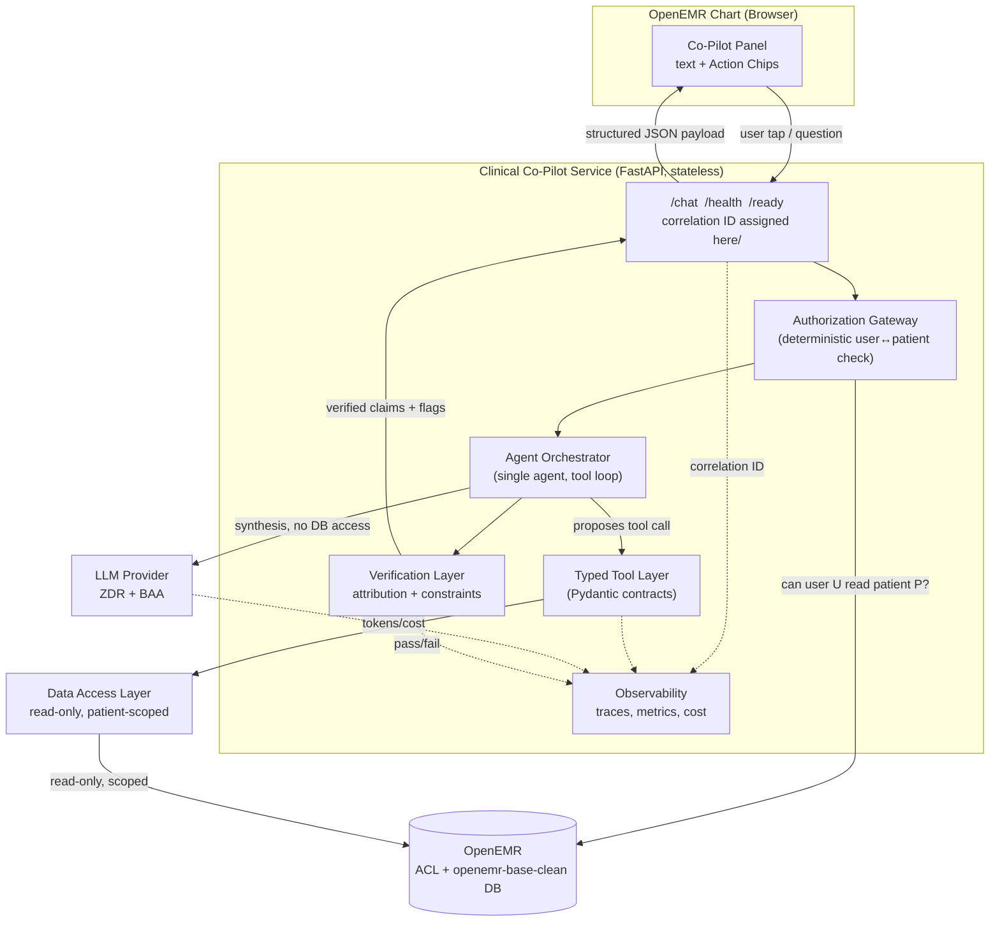

# W1_ARCHITECTURE.md — Clinical Co-Pilot (Week 1)

**Project:** AgentForge — Clinical Co-Pilot embedded in OpenEMR
**Target user:** the physician — an outpatient internal-medicine PCP with a full patient schedule and a 90-second between-rooms workflow (see `USERS.md`)
**MVP scope:** The *between-rooms, single-patient briefing* flow. The agent is **read-only** — it surfaces context, never writes or places orders. The pre-clinic panel scan is parked as a **fast-follow batch wrapper over the same tool contracts** (§14), not MVP.

---

## 1. Summary (~500 words)

The Clinical Co-Pilot is an AI agent embedded in the OpenEMR patient chart that gives the physician a trustworthy, source-attributed briefing in the 90 seconds she has walking into a room. **OpenEMR remains the system of record; the Co-Pilot is a thin, read-only integration beside it** — the physician stays in the EHR, with no separate app and no replacement of OpenEMR. Every architectural decision is filtered through three lenses: **Economics** (time is the scarce resource), **Psychology** (interaction friction kills adoption), and **Technology** (grounding is a hard invariant, not a feature).

**Deployment shape.** The agent runs as a **stateless Python sidecar (FastAPI)** alongside the OpenEMR PHP monolith, embedded in the chart UI as a panel. We reject embedding the agent in PHP: the Python ecosystem (agent frameworks, Pydantic contracts, eval/observability tooling) is where this problem is solved, and a clean service boundary is easier to secure, test, and scale independently. **Deployment:** the system ships as **one Railway project** — OpenEMR web (public) + MariaDB (private) + the FastAPI sidecar (private), with the LLM and observability external; only OpenEMR is publicly exposed, and Render is the fallback (§15).

**The LLM is untrusted.** It proposes tool calls; it never touches the database and never makes authorization decisions. Authorization is **two-layer**: we **delegate the ACL/role decision to OpenEMR's own gacl engine** (`AclMain::aclCheckCore`) and never re-implement the ACL engine — but OpenEMR's gacl is **section/category-based, not per-patient by default**, so the deterministic **Authorization Gateway composes an explicit *user ↔ patient* scope on top** (a scoping layer the core leaves to the caller) on every single tool call. That composition is a scope OpenEMR delegates to callers, **not** a re-implementation of its permissions. All data reads are patient-scoped, column-scoped, read-only, and parameterized.

**Economics lens → two-phase response.** Phase 1 is a **prefetched, parallel tool fan-out** triggered when the physician opens the chart — reason for visit, latest vitals, recent care transitions (e.g., an ED visit), active meds, and can't-miss flags — assembled into a briefing and streamed as first meaningful content inside ~1.5s. Deep historical parsing is deliberately **deferred to Phase 2** (follow-up turns), protecting her time window. We treat 1.5s as time-to-first-content via prefetch + streaming, not as a full agentic round-trip guarantee.

**Psychology lens → conversation, accelerated.** The core is a **conversational agent**: the physician drives a multi-turn conversation, and typed free text and taps are **co-equal entries to the same agent** — never a fallback ranked below tapping. What time pressure adds is a way to skip the blank box: every response also carries dynamic **Action Chips** (e.g., `[🔍 Why was he in the ED?]`, `[📈 A1c trend]`) that **predict the likely next turn** and let her take it with a single tap. Chips are bound to allowed tool intents, not free text — but whether she types or taps, both paths hit the **same agent, tools, and safety gates**, so steering is frictionless *and* safe.

**Technology lens → hard source attribution.** The core invariant: **every factual claim is bound to a real primary key** in the `openemr-base-clean` schema (`form_encounter.id`, `billing.id`, `prescriptions.id`, `procedure_result.procedure_result_id`, `lists.id`). A deterministic **Verifier** runs before any text reaches the user: claims whose cited PK was not actually returned by a tool this turn are **quarantined**, never shown as fact. A separate deterministic **constraint engine** flags allergy/interaction/threshold violations from structured data — and those flags are always surfaced, never suppressed. LLM-as-judge is used only as an optional semantic supplement, never as the safety gate, because a hallucinating judge cannot be a safety mechanism.

**Cross-cutting invariants.** A unique **correlation ID** threads every log line, tool call, and LLM interaction. Distinct `/health` (liveness) and `/ready` (validates OpenEMR + LLM + observability reachability) endpoints. Strict Pydantic/Zod contracts are the source of truth for every boundary. The agent tier holds **no PHI at rest** (stateless); LLM calls are **ZDR + BAA** (no retention, no training); PHI never enters logs — we log source refs and IDs, not values.

**Known tradeoffs** are catalogued in §14. The two that matter most: (1) direct read-only DB access vs. the OpenEMR API — we chose direct reads for latency and raw-PK attribution, but bought back safety by delegating *authorization* to OpenEMR; (2) a single agent vs. multi-agent — single agent, because the latency budget and use cases don't justify orchestration overhead.

---

## 2. Scope & Traceability

Every capability below traces to a use case in `USERS.md`. If a capability has no use case, it is not built.

| Capability | Traces to use case | Justifies |
| --- | --- | --- |
| Multi-turn conversation (core interface) | UC-1 Between-room briefing (branches under pressure) | Follow-ups are unpredictable; static UI can't anticipate them. Action Chips accelerate this conversation (pre-composed next turns) but don't replace typed free text |
| Tool chaining | UC-1, UC-2 (briefing → "why the ED visit?" → labs from that encounter) | One question's answer seeds the next |
| Care-gap / can't-miss surfacing | UC-2 | Relevance is contextual to *today's* visit |
| Grounded targeted lookup | UC-3 | Faster than tab-clicking; every answer source-attributed |

**Explicitly out of MVP scope:** panel scan (§14), write-back / order placement (read-only agent), generic medical Q&A (this agent knows *this* patient, not medicine in general).

---

## 3. Design Framework: Three Lenses → Architecture

| Lens | Force | Architectural consequence |
| --- | --- | --- |
| **Economics** | Absolute scarcity of time (90s) and cognitive bandwidth | Two-phase response (§5); prefetch on chart-open; parallel tool fan-out; defer deep history |
| **Psychology** | Interaction friction → non-adoption | Conversational agent as core; Action Chips as suggested-reply accelerants (never a replacement for free text) (§6); no *bare* blank box |
| **Technology** | A confident hallucination can harm a patient | Hard source attribution invariant + deterministic verification (§9); LLM untrusted |

---

## 4. System Architecture



**Component responsibilities**

1. **Co-Pilot Panel (frontend).** Embedded in the OpenEMR chart. Renders the JSON payload: briefing text, source citations, constraint flags, and Action Chips. Sends taps/questions with the active `pid` and session.
2. **Service API (FastAPI).** Entry point. Assigns the correlation ID, exposes `/chat`, `/health`, `/ready`. Stateless per request.
3. **Authorization Gateway.** The trust boundary. Validates the OpenEMR session/user and resolves the *user ↔ patient* relationship against OpenEMR's authoritative ACL **before any read**. Denials return a clean refusal; nothing downstream runs.
4. **Agent Orchestrator.** Single agent. Runs the tool-calling loop, manages ephemeral conversation state (source refs + correlation ID, no raw PHI persisted), and drives the two-phase response. The LLM plans; it has no DB handle.
5. **Typed Tool Layer.** The only path to data. Each tool has a strict Pydantic input/output contract, is patient-scoped, and returns records carrying `SourceRef`s.
6. **Data Access Layer.** Read-only DB user against `openemr-base-clean`. Parameterized, column-scoped queries. Returns raw primary keys for attribution.
7. **Verification Layer.** Deterministic. Source-attribution verifier + domain-constraint engine (§9). Runs on every response before it reaches the user.
8. **Observability.** Correlation-ID propagation, structured logging, tracing (**LangSmith** or equivalent), metrics, dashboards, alerts (§11).
9. **LLM Provider.** Stateless, ZDR + BAA. Receives structured record data as *data*, never as instructions (§13 prompt-injection).

---

## 5. Two-Phase Response Model (Economics Lens)

**Phase 1 — Warm briefing (target ≤ ~1.5s time-to-first-content).**
- Triggered on **chart-open**, before the physician clicks the co-pilot (prefetch), so the LLM/tool latency overlaps her walk down the hall.
- A **fixed, parallel fan-out** of high-leverage tools: reason for visit, latest vitals, recent care transitions (ED/inpatient since last visit), active meds, can't-miss flags.
- Briefing is **streamed**; structured payload assembled from tool outputs so first content is fast even if full synthesis lags.

**Phase 2 — Deferred depth (on tap / follow-up).**
- Deep historical parsing (full labs trends, note history, prior encounters) runs only when she asks or taps a chip.
- This is where multi-turn + tool chaining live — and it's justified precisely because we *deferred* it out of Phase 1 to protect her time.

**Latency honesty:** We do not claim a full agentic LLM turn returns in 1.5s. The 1.5s target is time-to-first-meaningful-content, achieved via prefetch + parallelism + streaming. Measured p50/p95 for full turns will be reported from observability (§11).

---

## 6. Interaction Model: Conversation First, Accelerated by Suggested Replies (Psychology Lens)

The core interface is a **conversational agent**: the physician holds a multi-turn conversation with it, and **typed free text is first-class** — never a fallback ranked below tapping. On top of that conversation, every response payload also includes **Action Chips** — **pre-composed likely next turns** rendered as single-tap buttons, so under time pressure she can advance the conversation without composing a message from a blank box.

- Chips are generated per turn based on what the briefing surfaced (an ED visit → `[🔍 Why was he in the ED?]`; an overdue screening → `[📅 Review screening]` where in-scope; a med → `[📈 A1c trend]`). Each chip is simply a **pre-composed turn** the physician could have typed herself.
- **Safety:** a chip's `intent` is an enum bound to an allowed tool call with typed params — never free-form text the model could be tricked into crafting. Chips cannot invoke anything the deterministic layer wouldn't already authorize.
- **Both paths converge.** Whether she types free text or taps a chip, the request passes through the **same Authorization Gateway and the same Verifier** — chips are an accelerant on the conversation, not a separate, less-guarded channel.

---

## 7. Authorization & Trust Boundaries

**Core principle: the LLM proposes, the tools dispose. Authorization is deterministic and out-of-band from the model.**

- **Trust boundary** sits at the Authorization Gateway, which enforces authorization in **two layers**. (1) It **delegates the ACL/role decision to OpenEMR's own gacl** (`AclMain::aclCheckCore`) and never re-implements the ACL engine — it is the system of record. (2) Because gacl is **section/category-based, not per-patient by default**, the gateway then **composes an explicit *user ↔ patient* scope on top** (a scoping layer the core leaves to the caller) before any read. This composition is a scope OpenEMR delegates to callers, **not** a re-implementation of its permissions.
- The agent can never hold **more privilege than the requesting user**. A resident's or nurse's narrower access would flow through unchanged (multi-user is native to the design, even though MVP centers on the physician).
- The LLM has **no database handle** and **no authorization authority**. Even a fully prompt-injected model can only emit tool-call *requests*, which are independently authorized and scoped.
- Every authorized access is **audit-logged** (who, which patient, when, correlation ID) — satisfying HIPAA access-tracking.

---

## 8. Data Access Layer (over `openemr-base-clean`)

Read-only, patient-scoped, parameterized. Each returned record carries a `SourceRef` to a real PK so attribution is possible end-to-end.

| Domain | Primary source table(s) | Source-ref PK |
| --- | --- | --- |
| Encounters / reason for visit | `form_encounter` | `form_encounter.id` |
| Care transitions (ED / inpatient) | `form_encounter` (+ facility/type) | `form_encounter.id` |
| Vitals | `form_vitals` | `form_vitals.id` |
| Medications | `prescriptions` (and `lists` type=`medication`) | `prescriptions.id` / `lists.id` |
| Problems / allergies | `lists` (type=`medical_problem` / `allergy`) | `lists.id` |
| Labs | `procedure_result` (+ `procedure_order/report`) | `procedure_result.procedure_result_id` |
| Billing / coded dx | `billing` | `billing.id` |

**Data-quality note:** OpenEMR stores some clinical facts in more than one place (e.g., meds in both `prescriptions` and `lists`). The tool layer abstracts this; the `SourceRef` points to whichever authoritative row the value came from. Missing/inconsistent fields are handled as failure modes (§12), not silently smoothed. (Full findings in `AUDIT.md`.)

---

## 9. Verification System (Technology Lens — the invariant)

Two guarantees, both **deterministic-first**.

### 9.1 Hard source attribution

**Invariant:** no claim reaches the physician as fact unless it is bound to a PK that a tool actually returned this turn.

```
evidence_set ← { all SourceRefs returned by tools during this turn }

for each claim in agent_output.claims:
    if claim.source_refs is empty
       or any ref not in evidence_set:
        quarantine(claim)          # never shown as fact; logged
    else:
        accept(claim)

# The model cannot cite a PK it never received → fabricated
# citations fail closed.
```

- Quarantined claims are either dropped or shown explicitly as **"unverified — needs chart review,"** never mixed into the trusted briefing.
- This catches the exact failure mode the case study warns about: a confidently stated hallucination.

### 9.2 Domain-constraint enforcement

Runs over **structured evidence, not the model's prose**, so it can't be talked out of firing.

- Allergy ↔ active-medication contraindication.
- High-risk drug–drug interaction pairs (curated set for MVP; RxNorm-backed expansion later).
- Value vs. reference range (surface `procedure_result.abnormal` and threshold breaches).

Constraint flags are **always surfaced, never suppressed** — a response that hides a violation is a failure, not a feature.

### 9.3 Known limitations (stated, per the case study)

- MVP constraint set is curated and narrow; it is not a full clinical rules engine.
- Attribution verifies *provenance* (the PK exists and was retrieved), and field-level match for key values; it does not fully verify clinical *interpretation*.
- LLM-as-judge is available only as an optional semantic cross-check and is **never** the sole gate.

---

## 10. Data Contracts (source of truth)

Strict schemas define every boundary. Pydantic on the service; Zod mirrors the client-facing payload.

### 10.1 Pydantic (service)

```python
from __future__ import annotations
from enum import Enum
from typing import Literal
from pydantic import BaseModel, Field

# ---- Attribution primitives -------------------------------------------------

SourceTable = Literal[
    "form_encounter", "form_vitals", "prescriptions",
    "lists", "procedure_result", "billing", "patient_data",
]

class SourceRef(BaseModel):
    table: SourceTable
    primary_key: int = Field(..., description="Real DB PK of the source row")
    label: str = Field(..., description="Human label, e.g. 'ED visit 2026-06-14'")

class Claim(BaseModel):
    text: str
    source_refs: list[SourceRef] = Field(default_factory=list)

# ---- Requests ---------------------------------------------------------------

class ChatRequest(BaseModel):
    correlation_id: str
    user_id: int                 # authenticated OpenEMR user
    pid: int                     # single-patient scope
    message: str | None = None   # free text (optional)
    chip_intent: "ChipIntent | None" = None   # tap-driven path

# ---- Tool I/O (example: care transitions) -----------------------------------

class ToolRequest(BaseModel):
    correlation_id: str
    user_id: int
    pid: int

class Encounter(BaseModel):
    source: SourceRef
    date: str
    kind: Literal["office", "ed", "inpatient", "other"]
    reason: str | None = None
    provider: str | None = None

class CareTransitionsResult(BaseModel):
    encounters: list[Encounter]
    truncated: bool = False       # Phase-1 depth cap flag

# ---- Verification -----------------------------------------------------------

class ConstraintSeverity(str, Enum):
    info = "info"; warning = "warning"; critical = "critical"

class ConstraintFlag(BaseModel):
    kind: Literal["allergy_interaction", "drug_drug", "threshold"]
    severity: ConstraintSeverity
    message: str
    source_refs: list[SourceRef]

class VerificationResult(BaseModel):
    verified_claims: list[Claim]
    quarantined_claims: list[Claim]
    constraint_flags: list[ConstraintFlag]

# ---- Steering ---------------------------------------------------------------

class ChipIntent(str, Enum):
    explain_care_transition = "explain_care_transition"
    lab_trend              = "lab_trend"
    med_detail             = "med_detail"
    care_gaps              = "care_gaps"

class ActionChip(BaseModel):
    label: str                    # e.g. "🔍 Why was he in the ED?"
    intent: ChipIntent            # enum-bound, not free text
    params: dict[str, int] = Field(default_factory=dict)  # e.g. {"encounter_pk": 812}

# ---- Response ---------------------------------------------------------------

class AgentResponse(BaseModel):
    correlation_id: str
    briefing: list[Claim]                 # only verified claims
    constraint_flags: list[ConstraintFlag]
    action_chips: list[ActionChip]
    degraded: bool = False                # partial data? (see §12)
    notes: str | None = None              # e.g. "Labs unavailable this turn"
```

### 10.2 Zod (client payload mirror)

```typescript
import { z } from "zod";

const SourceRef = z.object({
  table: z.enum([
    "form_encounter","form_vitals","prescriptions",
    "lists","procedure_result","billing","patient_data",
  ]),
  primary_key: z.number().int(),
  label: z.string(),
});

const Claim = z.object({
  text: z.string(),
  source_refs: z.array(SourceRef),
});

const ConstraintFlag = z.object({
  kind: z.enum(["allergy_interaction","drug_drug","threshold"]),
  severity: z.enum(["info","warning","critical"]),
  message: z.string(),
  source_refs: z.array(SourceRef),
});

const ActionChip = z.object({
  label: z.string(),
  intent: z.enum(["explain_care_transition","lab_trend","med_detail","care_gaps"]),
  params: z.record(z.number().int()).default({}),
});

export const AgentResponse = z.object({
  correlation_id: z.string(),
  briefing: z.array(Claim),
  constraint_flags: z.array(ConstraintFlag),
  action_chips: z.array(ActionChip),
  degraded: z.boolean().default(false),
  notes: z.string().nullable().optional(),
});
```

---

## 11. Observability

- **Correlation ID** assigned at `/chat`, propagated into every log line, tool call, and LLM request/response so a full trace reconstructs from logs alone.
- **Tracing/metrics:** **LangSmith** (or equivalent) via the `langsmith` SDK (`@traceable`) captures each turn as one trace with nested spans (authz → tools → LLM → verifier): the step sequence, per-step latency, tool successes/failures, retries, token usage, and cost per request, keyed by correlation ID.
- **Dashboard (LangSmith Monitor):** request count, error rate, p50/p95/p99 latency, tool-call counts, retry counts, **verification pass/fail rate**, and cost. Custom run metadata carries the brief's extras (verification outcome, quarantined-claim count) so they chart and filter.
- **Alerts (3 defined):** (1) **p95 latency** > threshold; (2) **error rate** > threshold; (3) **tool-failure rate** > threshold — as LangSmith alert rules (fallback: a documented threshold + scripted check). Each has a documented meaning and an on-call response note.
- **PHI discipline:** logs carry correlation IDs, `pid`, and source PKs — **never PHI values**. LangSmith traces do hold the LLM's clinical I/O; on synthetic demo data this is fine, and the documented production control is a **BAA with LangSmith or PHI-redaction before tracing**.

**Endpoints:**
- `/health` — process liveness only.
- `/ready` — validates real dependencies: OpenEMR reachable, LLM provider reachable, observability backend reachable. Never returns 200 unconditionally.

---

## 12. Failure Modes & Graceful Degradation

A clinical tool that crashes or silently fails is worse than none.

| Failure | Behavior |
| --- | --- |
| A tool times out / errors | Return partial briefing, set `degraded=true`, state explicitly ("Labs unavailable this turn") — never fabricate |
| Incomplete/missing record fields | Surface the gap ("no recent A1c on file"); never infer a value |
| LLM returns unparseable / unschema'd output | Reject via contract validation, retry once, else fall back to a deterministic template briefing from tool outputs |
| Unattributed claim | Quarantined by the verifier (§9.1) — fails closed |
| Authorization denial | Clean refusal; nothing downstream executes; audit-logged |
| Dependency down at `/ready` | Marked not-ready; load balancer withholds traffic |

---

## 13. Security & HIPAA

- **PHI at rest:** none in the agent tier (stateless). Conversation state is ephemeral and holds source refs + correlation IDs, not raw PHI.
- **LLM calls:** ZDR + BAA — no retention, no training use (per project instruction to assume signed BAAs).
- **Transport & secrets:** TLS everywhere; API keys in a secrets manager, never in code/logs.
- **Audit logging:** every patient access recorded (who/what/when + correlation ID) for HIPAA access-tracking and breach-investigation readiness.
- **Prompt injection:** EHR free-text notes are **untrusted content**. Record text is passed to the model as data with structural separation, never as instructions. Because authorization is deterministic and the model holds no privileged handle, a successfully injected instruction still cannot read an unauthorized patient or alter data — it can at most produce claims, which the verifier then checks against real records.
- **Data retention / breach obligations:** covered in depth in `AUDIT.md` (Compliance pass).

---

## 14. Trade-off Ledger (considered → rejected)

| Decision | Chosen | Considered & rejected | Why |
| --- | --- | --- | --- |
| Where the agent lives | Stateless Python sidecar (FastAPI) | Embed in OpenEMR PHP monolith | PHP lacks the agent/eval/observability ecosystem; monolith coupling hurts testing, scaling, and security isolation |
| Data access | Direct **read-only** DB access, patient-scoped | OpenEMR REST/FHIR API for all reads | API adds HTTP+PHP latency and abstracts away raw PKs we need for hard attribution. **We bought back safety by delegating *authorization* to OpenEMR's ACL** rather than the DB path |
| Authorization | Deterministic gateway: delegate the ACL/role decision to OpenEMR gacl, **compose** the per-patient scope on top | Let the agent/LLM reason about permissions; *or* re-implement OpenEMR's ACL engine | Never trust a model with authz; never re-implement the ACL engine. But gacl is section/category-based (not per-patient by default), so the gateway composes the *user ↔ patient* scope the core leaves to the caller — a scoping layer, not a re-implementation |
| Agent topology | Single agent | Multi-agent orchestration | Latency budget + MVP use cases don't justify orchestration overhead and added failure surface |
| Verification | Deterministic attribution + constraint engine | LLM-as-judge as the primary gate | A hallucinating judge can't be a safety mechanism; determinism fails closed |
| Phase-1 briefing | Prefetch + parallel fan-out + streaming | Single synchronous full-LLM synthesis | Can't reliably hit the time-to-first-content target with one blocking LLM call |
| Interaction | Conversational agent (free text first-class) + Action Chips (bound intents) as suggested-reply accelerants | A **bare** blank box with no guidance | We do **not** reject free-text conversation — it is the core interface. We reject a *bare* blank box: under time pressure it causes choice paralysis. Chips add pre-composed next turns on top; bound intents keep them frictionless *and* safe |
| Panel scan | **Parked** as batch wrapper over same tools | Build it into MVP | Different (batch/async) latency profile; keeps MVP focused, fast, defensible. Same tool contracts make it a clean fast-follow |
| LLM provider | Hosted frontier model, ZDR + BAA (MVP) | Self-hosted open model now | Ops burden + quality gap now; self-hosting becomes attractive at 10K–100K users (see cost analysis) — designed for, not built yet |
| Deployment host | **Railway** (one project) | Render-first / split hosts | OpenEMR's Docker-Compose shape (OpenEMR + MariaDB + volumes) maps to Railway multi-service; Render kept as fallback. Failure behavior: if platform friction appears, split services or fall back to Render Docker |
| Write scope | **Read-only** tools (no mutations) | Write-capable agent | Reduces clinical blast radius in the MVP; an unsafe action refuses and never mutates. If the sidecar is down, OpenEMR still works and the panel shows unavailable |

---

## 15. Deployment — Railway

The whole system deploys as **one Railway project**, matching OpenEMR's Docker-Compose shape (OpenEMR + MariaDB + volumes) and keeping the MVP and the final agent on the **same infrastructure** (per the case study).

| Service | Exposure | Role |
| --- | --- | --- |
| OpenEMR web (Apache/PHP, Docker) | **Public** | The EHR + the embedded Co-Pilot panel (`interface/`) |
| MariaDB | **Private** | OpenEMR's database; the sidecar reads it via a read-only user |
| Co-Pilot sidecar (FastAPI) | **Private** | Agent, tools, gateway, verifier; reached by the panel |
| LLM provider + LangSmith | **External** | Model calls (BAA + ZDR) and observability tracing |

- **Only OpenEMR is public.** The sidecar and DB sit on Railway's private network, so no PHI-bearing endpoint is exposed publicly.
- **Integration surface:** the panel embeds in OpenEMR's `interface/`; the sidecar authorizes via **gacl** and reads MariaDB read-only, with OpenEMR's **OAuth2 FHIR API** as the auth-respecting alternative path.
- **Week 1 phasing:** deploy the OpenEMR fork now (Stage 2 hard gate = a live public URL), then add the sidecar into the same topology for Early Submission.
- **Fallback:** if Railway multi-service friction appears, split services or fall back to **Render Docker** — the Compose shape ports directly. Host choice doesn't change the architecture.
- **Posture:** the MVP is deliberately constrained so it fails safely — it bends toward safety, attribution, and predictable degradation (§12).

---

## 16. Open Questions / Next Steps

- Confirm the exact OpenEMR ACL check surface for the *user ↔ patient* resolution (API call vs. session context) during the audit.
- Finalize the MVP constraint set (which interaction pairs, which thresholds) with a clinical-plausibility pass.
- Validate the 1.5s time-to-first-content target against measured p50/p95 once deployed; adjust prefetch triggers accordingly.
- Panel-scan fast-follow: specify the batch scheduler and precompute/caching layer over the shared tool contracts.
