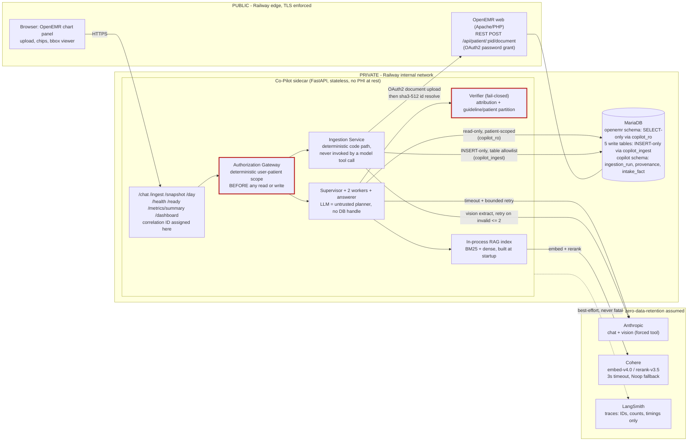
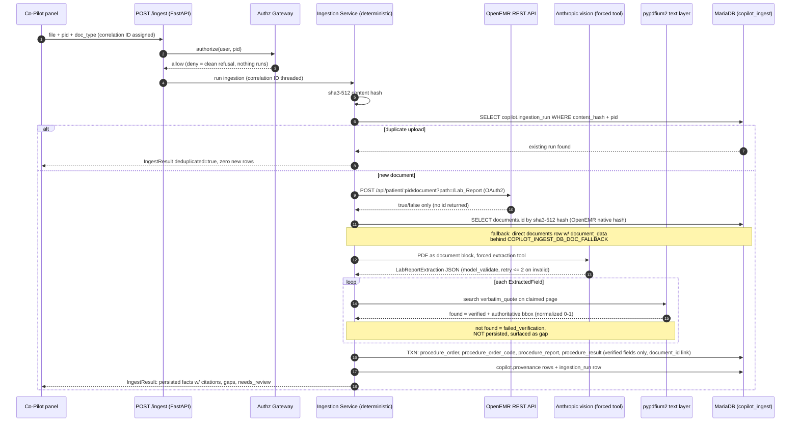
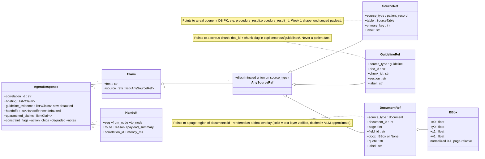
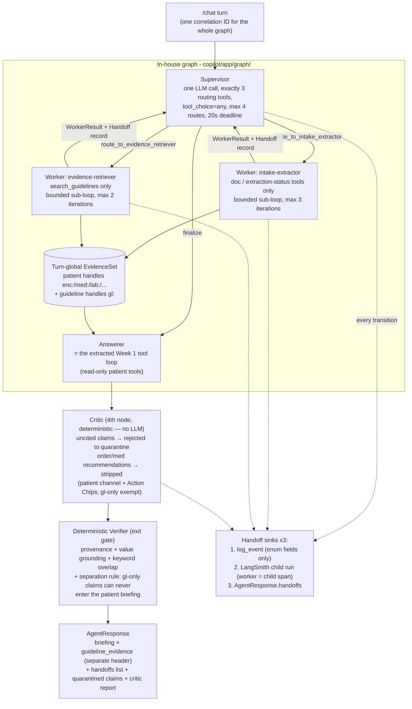
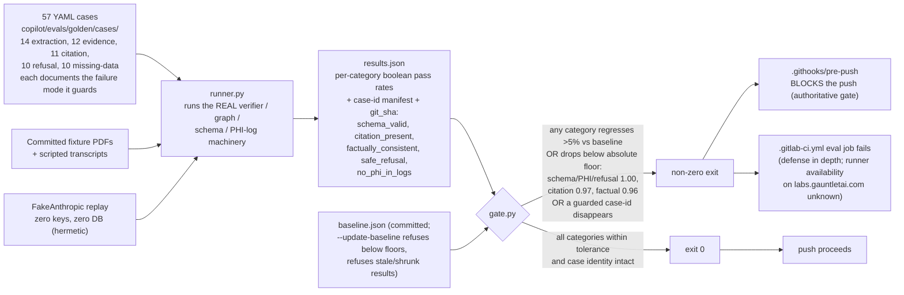

# W2_ARCHITECTURE.md — Clinical Co-Pilot, Week 2: Multimodal Evidence Agent

> **Status: AS-BUILT (updated 2026-07-16 for the Early Submission).** This document was authored as a pre-implementation defense draft and has been reconciled to what actually shipped on `feat/week2-mvp`: module names, endpoints, the discriminated-union citation contract, the eval gate (tightened floors), and the hardened gate/ingestion/verifier code paths all reflect the merged tree. Latency figures marked *(target)* are validated by the committed `copilot/scripts/report_latency.py` harness (§2.1, `SLOS.md` §4); everything else is verified against the code.
>
> **As-built delta at a glance:** the golden set grew 50 → 57 cases and its floors tightened (citation `0.97`, factual `0.96`; safety categories `1.00`); a 6-finder adversarial review found **21 confirmed defects**, all fixed with fail-before/pass-after tests (new **§14**, audit trail `copilot/evals/review_findings_w2.json`); the OpenAPI spec is exported to a committed `copilot/openapi.json` with a drift-guard test (§9.5). **Early-submission wave (2026-07-16, grader feedback + remaining deliverables):** `/ready` grew the rubric sub-checks `vector_index` / `reranker` / `document_storage` (§9.7); `GET /labs/trend` + the panel's trend-chart widget shipped; deterministic clinical query expansion improved retrieval recall (§6.2); the `report_latency.py` measurement harness shipped (§9.8); per-node model tiers landed (`COPILOT_SUPERVISOR_MODEL` / `COPILOT_WORKER_MODEL` / `COPILOT_ANSWERER_MODEL`, empty = inherit) after the measured live run showed the turn is LLM-dominated — routing and worker sub-loops run on a Haiku-class tier while the physician-facing answerer keeps the main model; the deterministic verifier remains the quality guarantee at every tier.

**Companion documents:** [`W1_ARCHITECTURE.md`](./W1_ARCHITECTURE.md) (Week 1 architecture and the three-lens framework), [`USERS.md`](./USERS.md) (the persona every capability traces to), [`AUDIT.md`](./AUDIT.md) (the data-model pitfalls this design works around), [`CLAUDE.md`](./CLAUDE.md) (the nine non-negotiable invariants). Diagram sources and rendered PNGs live in [`defense/week2/diagrams/`](./defense/week2/diagrams/); the anticipated-challenge Q&A sheet is [`defense/week2/QA.md`](./defense/week2/QA.md).

---

## 1. What Week 2 adds and why

**The scenario (from the assignment):** the physician is prepping a follow-up visit. The chart has structured OpenEMR data, but the important recent information is buried in a lab PDF and a patient intake form the front desk uploaded. She asks: *what changed, what should I pay attention to, and what evidence supports the recommendation?*

That is the Week 1 question — *"what changed since last visit, and what can't I miss?"* (USERS.md §2) — with two new realities added: **the answer now partly lives in documents, not rows**, and **"what's the evidence?" needs guideline knowledge, not just this patient's chart**. Week 2 is therefore not a new product; it is the same 90-second between-rooms briefing with two new evidence sources wired into the same verified pipeline.

Four capabilities are added. Each traces to the Week 1 persona and workflow — the graders' traceability requirement, and ours:

| Week 2 capability | Traces to | Why it serves the 90-second workflow |
| --- | --- | --- |
| **Document ingestion + vision extraction** (lab PDF, intake form) | UC-1 (between-room briefing: "what changed") — the change she'd otherwise miss is in an uploaded PDF, exactly her stated failure mode ("missing what mattered", USERS.md §1) | Ingestion runs **before the visit** (front desk uploads → async extract → facts land in `procedure_result`/`lists`). By the time she's between rooms, the document's facts are ordinary chart rows the existing briefing already surfaces — at **zero marginal wait** |
| **Per-field citations with bbox overlay** | UC-3 (targeted grounded lookup: "every answer source-attributed") | Trust in 90 seconds requires *seeing* the source. A citation chip opens the page image with the exact region highlighted — verification made visible at the point of care |
| **Hybrid RAG over an office-guideline corpus** | UC-2 (care-gap surfacing: "anything overdue or flagged?") — gap detection needs the office's agreed protocols (screening intervals, A1c targets), not just patient rows | Guideline evidence answers *"what evidence supports the recommendation?"* — rendered under a **separate header** so reference knowledge is never confused with this patient's chart |
| **Supervisor + 2 workers with logged handoffs** | UC-1's branching follow-ups now span three evidence kinds (chart rows, extracted documents, guidelines) | Routing decides which evidence kind a turn needs, within the same 20s turn deadline. Handoffs are inspectable, so "how was this answer assembled?" has an auditable answer |

The corpus itself is chosen for this persona: ADA Standards of Care, ACC/AHA hypertension, KDIGO CKD, ACC/AHA heart failure, USPSTF screening, statin/ASCVD, metformin–eGFR dosing, adult immunizations — the DM/HTN/CKD/CHF chronic-disease mix that fills her schedule (USERS.md §1).

What Week 2 does **not** change: OpenEMR remains the system of record; the agent remains read-only; the verifier remains the exit gate; the panel remains embedded in the chart. §13 lists what we deliberately did not build.

---

## 2. The three lenses applied to Week 2

Week 1's design framework (W1_ARCHITECTURE.md §3) carries forward unchanged: every capability is designed and defended through **Economics**, **Psychology**, and **Technology**.

### 2.1 Economics — ingestion off the critical path

The scarce resource is still the physician's 90 seconds. The single most important Week 2 economic decision: **document ingestion happens before the visit, not during it.** The front desk uploads; the sidecar extracts asynchronously; verified facts land in the chart as ordinary rows. The physician never waits on a VLM. An ingestion p95 of 30 seconds is perfectly acceptable *because it is off the critical path* — while `/chat` keeps its Week 1 deadline.

**SLO table.** These are the shipped budgets. The **hard limits** — the 20s turn deadline, the per-dependency timeouts, and the supervisor/worker route caps — are *enforced in code* (`config.request_deadline_s`, the `Timeout(...)` on each SDK/httpx client, `supervisor_max_routes`, `worker_max_iters`) and are covered by the forced-finalize and timeout tests. The **latency p50/p95 rows** are *design targets*, now validated by the committed `copilot/scripts/report_latency.py` measurement harness (client wall-clock percentiles per flow + a `/metrics/summary` scrape; reports in `copilot/load/latency_report.md`, usage in `copilot/SLOS.md` §4, which marks each row measured-vs-target). A standalone `SLOS.md` restates this table for ops.

| Path | SLO | Rationale |
| --- | --- | --- |
| `/chat` full turn | **20s hard deadline** (unchanged from Week 1) | The graph must forcibly finalize inside the same envelope the Week 1 loop honored |
| Time-to-first-content (briefing) | ~1.5s (unchanged Week 1 target) | Prefetch + streaming; Week 2 must not regress it (§9 baseline comparison) |
| Supervisor routing decision | **≤ 1.5s p95** | One LLM call with 3 forced routing tools — small prompt, forced `tool_choice` |
| Guideline retrieval (BM25 + dense + RRF + rerank) | **≤ 300ms in-process** (excl. external rerank; reranker hard timeout 3s → fallback) | Index is in-process, built at startup; retrieval must be invisible inside a turn |
| Document ingestion end-to-end (`POST /ingest` → facts persisted) | **p95 < 30s** | Off the critical path; dominated by one VLM vision call |
| Page image render (`GET /documents/{id}/page/{n}.png`) | fast after first hit (LRU-cached) | Citation click must feel instant on the second and later views |

"What changed?" now includes ingested-document facts at zero marginal wait — that is the economic story of Week 2.

### 2.2 Psychology — trust through visible provenance

Clinicians distrust OCR'd data, and they are right to. Week 2's answer is to make **confidence origin visible, not asserted**:

- **Solid bounding box** = the value was deterministically verified against the PDF's text layer (pdfium found the verbatim quote on the claimed page; the box is drawn from pdfium's own coordinates).
- **Dashed "approximate" box** = VLM-claimed region only — displayed for orientation, never persisted as fact.
- **Gaps are stated in words** ("collection date not found on this document"), never silently absent — the Week 1 "surface the gap, never infer" rule extended to documents.
- **Guideline evidence renders under a separate header** from patient facts. The physician must never wonder whether "target A1c < 7%" is a fact about *this patient* or a line from a protocol document.
- **The handoff trail is inspectable in the UI** — "how this answer was assembled" (supervisor → intake-extractor → evidence-retriever → answerer) is shown, not hidden, because a black-box router erodes the same trust the citations build.
- **The upload result card mirrors the Action Chips pattern**: structured, clickable (each persisted fact carries a citation chip), with the dedup notice explicit — no blank-box anxiety, no silent success.

### 2.3 Technology — a deterministic spine around an untrusted model

Week 1's rule was *the LLM proposes, deterministic code disposes*. Week 2 adds a VLM — a second untrusted model — and wraps it in the same spine:

- **Schema validation**: the VLM's only output channel is a forced tool whose `input_schema` is the Pydantic model's JSON schema; raw output cannot bypass validation (`model_validate`, retry ≤ 2).
- **Text-layer quote verification**: a deterministic pypdfium2 check that the model's verbatim quote actually exists on the claimed page, and the value inside it — the VLM cannot invent a lab value that survives to the database.
- **Fail-closed persistence**: unverified fields are **not persisted**, ever (`COPILOT_INGEST_ALLOW_UNVERIFIED=false`).
- **The verifier's partition rule**: a claim citing only guideline handles can never appear as a patient fact.
- **Boolean-rubric evals**: pass/fail per category, gated deterministically — no 1–10 vibes.

The LLM still never writes and still never holds a DB handle. All writes live in a **deterministic Ingestion Service** with its own least-privilege DB user (§4).

### 2.4 System shape

Two trust boundaries matter: the **Authorization Gateway** (nothing reads or writes before the deterministic user↔patient check) and the **Verifier** (nothing reaches the physician unverified). Both sit in deterministic code; neither can be talked out of firing.

---

## 3. Invariants preserved

Week 2 adds a write path, a second model, and a multi-agent graph — the three most plausible ways to break the Week 1 guarantees. The table below is the reconciliation, invariant by invariant (CLAUDE.md's nine non-negotiables):

| # | Invariant (CLAUDE.md) | How Week 2 preserves it |
| --- | --- | --- |
| 1 | **The LLM is an untrusted planner** — proposes tool calls only; no DB handle, no authorization authority | Unchanged for chat. The VLM is *more* constrained than the chat model: it cannot call tools at all — it can only fill a forced extraction schema, and deterministic code decides what (if anything) is persisted. The supervisor's LLM can only emit one of 3 routing tool calls |
| 2 | **Authorization is deterministic and two-layer** — gacl delegation + per-patient scope, checked before any read | `POST /ingest` passes through the same `authz.authorize(user_id, pid)` gateway before any byte of the file is processed. Workers inherit the turn's authorized `ToolContext`; no worker can widen scope (tool schemas still expose no `pid`) |
| 3 | **Read-only** — the agent never writes; tools use a read-only DB user | **The agent still never writes.** The new writes live in a deterministic **Ingestion Service** invoked by a FastAPI endpoint on an explicit human action (file upload) — never by a model tool call. `db.py`/`copilot_ro` are untouched. The writer uses a separate `copilot_ingest` DB user with INSERT-only grants on exactly 5 tables plus an in-code table allowlist (defense in depth). Agent tools remain read-only; there is no write tool in any tool registry (§4.2) |
| 4 | **Hard source attribution** — every claim binds to a real PK; deterministic verifier; fail-closed quarantine | Extended, not relaxed: the citation union (§5) adds `DocumentRef` (page + field + bbox + quote) and `GuidelineRef` (doc + chunk) alongside PK-based `SourceRef`. The verifier's evidence-handle check covers all three; fabricated `gl:` or document handles quarantine exactly like fabricated PKs |
| 5 | **Strict schemas are the source of truth** | All new boundaries are Pydantic contracts written in Step 0 before any implementation: `ExtractedField`, `LabReportExtraction`, `IntakeFormExtraction`, `IngestResult`, `EvidenceChunk`, `Handoff`, `WorkerResult`, `BBox`, the `AnySourceRef` union. Raw VLM output cannot bypass validation — the forced tool's schema *is* the Pydantic schema |
| 6 | **Observability from the start** — correlation ID threads everything | One correlation ID per request threads the entire graph: supervisor span → worker child runs → VLM call → pdfium verify → DB writes (persisted into `procedure_report.report_notes` as JSON) → provenance rows. A full multi-agent trace reconstructs from the correlation ID alone (§7.3) |
| 7 | **`/health` and `/ready` are separate; `/ready` checks real dependencies** | `/ready` extends to per-dependency states — `database`, `llm`, `observability`, plus `vector_index` and `reranker` (always) and `openemr_api` / `ingest_db` / `document_storage` (when ingest enabled) — returning `ready / degraded / down`, not a binary flip (§9.7) |
| 8 | **PHI safety** — stateless agent tier, never log PHI, BAA + ZDR, demo data only | The log allowlist (`correlation.py::_ALLOWED_LOG_KEYS`) is extended with enum-only Week 2 keys; **filenames are explicitly excluded** (they contain patient names). Handoff logs carry enum fields only, no free text. LangSmith gets IDs/counts/timings. Fixture documents are synthetic (reportlab-generated). Verified by the `no_phi_in_logs` rubric + log-capture tests in CI (§9.9) |
| 9 | **Graceful degradation** — partial, flagged, never fabricated | Every new dependency has a named degraded mode: Cohere down → BM25-only retrieval; reranker timeout → NoopReranker; scanned PDF → `needs_review`, not persisted; VLM schema-invalid after retries → ingestion fails with explicit gaps; RAG empty → answer says so. None of these block `/ready` to `down`; none fabricate (§11) |

The one invariant that *changes in letter but not in spirit* is #3 — and the letter was always "the **agent** never writes." It still doesn't. See §12's tradeoff ledger and `defense/week2/QA.md` Q1 for the full defense.

### 3.1 Authentication & authorization — the session-token overhaul (as-built)

Week 1 authenticated the browser panel with a **reusable static bearer** (`COPILOT_BEARER_SECRET`) injected into the page. Grader feedback flagged two real weaknesses: the bearer was a long-lived, reusable secret sitting in a browser context, and the sidecar treated "an existing user whose provider matches the patient" as the whole authorization decision — it never consulted OpenEMR's actual role/ACL engine. Both are fixed as-built. The shared contract is **`copilot/AUTH_TOKEN_SPEC.md`**; the flow:

1. **OpenEMR mints, after a real ACL check.** When the physician opens a chart, the Co-Pilot module (`Bootstrap.php`) calls `AclMain::aclCheckCore('patients','demo')` — OpenEMR's own gacl. A user who lacks that grant gets **no panel and no token** (the authoritative, role-based denial). If the check passes, `CopilotToken::mint()` (`CopilotToken.php`) issues a short-lived HMAC token bound to `sub` (the OpenEMR `users.id`), the selected `pid`, a `scope` (`patient` | `day`), the asserted `acl` (`"patients:demo"`), and `exp` (default **900s** TTL). "My Day" (`myday.php`) mints a `scope:"day"` token (`pid=0`); clicking a patient opens that chart, whose overlay mints a fresh `scope:"patient"` token.
2. **The token rides in the URL fragment.** OpenEMR builds the iframe src as `{sidecar}/?pid=X&embed=overlay#t=<token>`. Fragments are never sent to a server, so the token never lands in the sidecar's access logs. The panel JS reads `location.hash` and sends it as the `Bearer` value; **no `__COPILOT_TOKEN__` is injected into HTML** anymore.
3. **The sidecar verifies, fail-closed** (`app/session_token.py`, `app/main.py::require_session_token`). It recomputes `HMAC-SHA256` over the **literal base64url payload segment** (never a re-serialized JSON — this removes all PHP↔Python canonicalization fragility), compares constant-time, then decodes and checks `v==1`, required claims, and `exp` (60s skew). Any failure → **401** (`auth_reject` log event, reason enum only — the token is never logged).
4. **Two authorization layers, both must pass** (`app/main.py::enforce_patient`). Layer 1 (token binding): `scope=="patient"`, `claims.pid == request pid` (a token for patient A can never act on patient B → **403**), and `claims.acl=="patients:demo"`. Layer 2 (per-patient scope): the existing `authorize(claims.user_id, pid)` provider-match. **The ACL/role decision was already made by OpenEMR gacl at mint** — the sidecar does not re-implement it (invariant #2); the provider match is only the per-patient scope layer on top. `user_id` now comes from the **token**, never from a static `demo_user_id`.

**The signing key** lives in the `openemr` database (`copilot_signing_key`, id=1), seeded once by the runbook (`INSERT IGNORE`, stable across reseeds). OpenEMR PHP reads it natively; the sidecar reads it through the existing `copilot_ro` `SELECT ON openemr.*` grant (no cross-DB grant, no env-var change on the openemr service) and caches it ~60s so a rotation propagates. A missing key **fails closed** — no token can be trusted (`TokenInvalid("signing_key_unavailable")`).

**The static bearer is revoked.** `COPILOT_BEARER_SECRET` was exposed and must be rotated to an inert value on production; patient access now requires an OpenEMR-minted token exclusively.

**Dev mode (local only).** `COPILOT_AUTH_DEV_MODE=true` (**default false; NEVER true in production**) exposes `GET /dev/token` so the standalone UI and load tests can mint a `scope:"patient"` token without a running OpenEMR; `/dev/token` returns **404** whenever the flag is false, so the endpoint does not exist in prod.

**Denial test (grader requirement).** `bin/copilot_auth_check.php <username>` runs the real `AclMain::aclCheckCore('patients','demo',<username>)` inside the container: a user **with** the role prints `ALLOW` (exit 0), a user **without** it prints `DENY` (exit 3). It also self-tests `CopilotToken::mint` against the spec's golden interop vector. Sidecar-side, `copilot/tests/test_session_auth.py` covers the hermetic tiers (no token → 401, tampered/expired → 401, patient-A token on patient B → 403, valid-but-not-provider → 403, plus the golden vector). See `AUTH_TOKEN_SPEC.md` for the full contract and the Admin-UI fixture (an Accounting/Front-Office-role user that lacks `patients|demo`).

---

## 4. Document ingestion & extraction (Stage 1)

### 4.1 Flow

The code lives in `copilot/app/ingest/` (`pdf_text.py`, `extractor.py`, `verify_extraction.py`, `openemr_api.py`, `writer.py`, `provenance.py`, `service.py`) plus `copilot/app/ingest_routes.py` (`POST /ingest`, `GET /documents/{id}/meta`, `GET /documents/{id}/page/{n}.png`, `GET /documents/{id}/citations`). This is the assignment's `attach_and_extract(patient_id, file_path, doc_type)` capability, exposed as an endpoint rather than a model tool — deliberately, per invariant 3.

The same flow serves **three document types**; only the extraction contract and the persistence target differ (the service dispatches explicitly on the extraction type — never a catch-all else):

| `doc_type` | Extraction contract | Persists to (verified fields only) | Authority note |
| --- | --- | --- | --- |
| `lab_report` | `LabReportExtraction` | native lab chain: `procedure_order → procedure_order_code → procedure_report → procedure_result` | first-class chart labs; `procedure_result.document_id` links back to the source |
| `intake_form` | `IntakeFormExtraction` | meds/allergies → `lists`; chief concern/family history → `copilot.intake_fact`; demographics **compare-and-flag only** | `patient_data` is never written |
| `medication_list` | `MedicationListExtraction` | `lists` (`type='medication'`) **only** — one row per verified med name; verified-only strength/route/frequency/prescriber in `comments`; a verified `Discontinued/stopped/held/inactive` status writes `activity=0`; `begdate` from the verified list date | **never `prescriptions`** — a document-reported med must not gain prescriber authority (`tools/medications.py` treats `prescriptions` as the ordered-authority row; AUDIT.md divergence rule). Same write perimeter as intake: `lists` INSERT was already granted |

### 4.2 The write path (design decision D2) — hybrid, forced by the fork

**Source document — OpenEMR REST first.** The document itself is stored through OpenEMR's own front door: `POST /api/patient/:pid/document?path=/Lab_Report` (or `/Patient_Information` for intake forms), via OAuth2 password grant. The endpoint is verified present in this fork at `apis/routes/_rest_routes_standard.inc.php:496`. Going through the API means OpenEMR's own code creates the `documents` row, assigns the category, and computes its native content hash — the document round-trips through OpenEMR, satisfying the assignment's integrity requirement (no untraceable records).

One wrinkle: **the endpoint returns only true/false — no id.** We recover `documents.id` deterministically by SELECTing on the document's **sha3-512** content hash — the exact hash OpenEMR itself computes and stores (`Document.class.php:1114`). Same bytes, same algorithm, same value; no heuristic matching.

**Fallback (flagged):** the fork's OAuth2 flow depends on `oauth_keys` rows that may be absent on a fresh deploy (top risk #1). Behind `COPILOT_INGEST_DB_DOC_FALLBACK`, the service can insert the `documents` row directly (bytes in `document_data`, id via OpenEMR's `sequences` LAST_INSERT_ID idiom). The runbook's primary fix is registering the OAuth client and triggering key generation; the flag exists so a demo never dies on an auth-infrastructure gap. The fallback INSERT sets `documents.revision` **explicitly** (to the write timestamp): the production OpenEMR schema declares `revision` `NOT NULL` with no default (other schema versions default it to `CURRENT_TIMESTAMP`), so writing it explicitly makes the INSERT portable across both — a write-compat detail recorded in `MIGRATIONS.md` (§14 hardening).

**Derived lab facts — direct INSERTs, because no create API exists.** This fork exposes **no FHIR Observation/DocumentReference create and no REST lab-result create**. The only way to make extracted lab values first-class chart rows — visible to OpenEMR itself and to our Week 1 `get_labs` tool — is the native lab chain: `procedure_order → procedure_order_code → procedure_report → procedure_result`, written by `copilot_ingest` in a single transaction. `procedure_result.document_id` links every derived value to its source document, and the ingestion correlation ID is recorded as JSON in `procedure_report.report_notes` — so every row is traceable both to its document and to its ingestion trace.

**Intake form facts:**
- medications and allergies → `lists` (the table OpenEMR itself uses; type `medication` / `allergy`);
- **demographics → compare-and-flag only, never overwrite `patient_data`.** If the form says a different phone number than the chart, that is surfaced as a discrepancy for a human — the ingestion service does not silently mutate the system of record's demographic truth;
- chief concern and family history → the sidecar-owned `copilot.intake_fact` (no natural OpenEMR home that isn't a clinical-note write, which we refuse to fabricate).

**The `copilot` schema** (created by the seeder, `copilot/deploy/seeder/live_seed.sql`):

| Table | Purpose | Key constraint |
| --- | --- | --- |
| `copilot.ingestion_run` | One row per accepted upload: content hash, pid, doc type, status, correlation_id | `UNIQUE(content_hash, pid)` — **idempotency**: re-uploading the same file for the same patient is a no-op (zero new rows, explicit dedup notice) |
| `copilot.provenance` | Field-level lineage: `target_table`/`target_pk` ↔ document_id/field_id/page/bbox/confidence/quote | `UNIQUE(document_id, field_id)` — one provenance row per extracted field |
| `copilot.intake_fact` | Sidecar-owned intake facts (chief concern, family history) | — |

**Grants (least privilege, enforced twice):** `copilot_ingest` gets INSERT-only on exactly the 5 openemr tables (`documents` — fallback path only, `procedure_order`, `procedure_order_code`, `procedure_report`, `procedure_result`, plus `lists`) and ALL on `copilot.*`; no UPDATE, no DELETE, no SELECT beyond what id-resolution requires. `copilot_ro` gains SELECT on `copilot.*` so read tools can surface provenance. On top of the DB grants, the writer module keeps an **in-code table allowlist** — a second, independent enforcement of the same boundary, so a bug in one layer is caught by the other.

### 4.3 Extraction without invention (design decision D3)

The VLM is treated exactly like the chat LLM: a proposer whose output is worthless until deterministic code corroborates it.

1. **One Anthropic vision call** per document (PDF as a document content block) with a **forced tool** whose `input_schema` is generated from the Pydantic extraction model (`LabReportExtraction` / `IntakeFormExtraction`). The model cannot answer in prose; it can only fill the schema.
2. **`model_validate` with retry-on-invalid (max 2).** Schema-invalid output never propagates — it is re-prompted with the validation error, and after two failures the ingestion fails explicitly (§11).
3. **Every field is an envelope**, not a bare value: `ExtractedField{value, page, bbox, confidence, verbatim_quote, status}`. The model must say *where* it read the value and *quote the text it read* — the claims that make it falsifiable.
4. **Deterministic verification (the heart of it):** pypdfium2 opens the PDF's real text layer. For each field, the `verbatim_quote` must be found **on the claimed page**, and the `value` must **align to a token — or a contiguous run of tokens — of that quote** (`verify_extraction._value_in_quote` / `_tok_eq`, with numeric canonicalization). This is *token alignment, not raw substring containment*: the as-built check rejects a digit-drop like `42` inside `142` or a unit `g` inside `mg/dL`, which a substring test would have passed (review finding, §14). If found, the field is `verified` and gets its **authoritative bbox from pdfium's text search** (normalized 0–1 coordinates) — not the VLM's guess. VLM-supplied bboxes are known-unreliable; they are kept only as dashed "approximate" display hints, never as the verified region.
5. **Fail-closed non-persistence:** any field whose quote is not found is `failed_verification` — **not persisted** to any table, surfaced in `IngestResult.gaps`. `COPILOT_INGEST_ALLOW_UNVERIFIED=false` is the default and the demo configuration; there is no code path that persists an unverified value while it is false.
6. **Scanned documents (no text layer):** verification is impossible, so nothing is persisted. All fields return `needs_review` with the VLM bbox for display only. The physician sees "this document needs human review," not silently-invented rows. (`lab_scanned.pdf` is a committed fixture precisely to prove this path.)
7. **Missing fields → `not_found`, listed in `gaps`, never invented.** Required-field lists (test name, value, unit, reference range, collection date, abnormal flag for labs; demographics, chief concern, meds, allergies, family history for intake) come from the assignment; a document that lacks one produces a gap, not a guess.

The net guarantee, stated the way a grader will test it: **a value hallucinated by the VLM cannot reach the database**, because a hallucinated value has no verbatim quote in the real text layer, and quote verification is deterministic code the model cannot negotiate with.

---

## 5. Citation contract (design decision D1)

### 5.1 The discriminated union

Week 1 had one citation type: `SourceRef{table, primary_key, label}` — a real DB PK. Week 2 has three evidence kinds, so the contract becomes a **discriminated union** in `copilot/app/contracts.py`:

- `SourceRef` — unchanged fields, plus `source_type: Literal["patient_record"]`. Week 1 payloads are byte-compatible (additive with a default).
- `GuidelineRef{source_type: "guideline", doc_id, chunk_id, section, label}` — a corpus chunk, never a patient fact.
- `DocumentRef{source_type: "document", document_id, page, field_id, bbox: BBox | None, quote, label}` — a region of a stored document; `BBox` is normalized 0–1, page-relative.
- `AnySourceRef = Annotated[Union[SourceRef, GuidelineRef, DocumentRef], Field(discriminator="source_type")]`; `Claim.source_refs: list[AnySourceRef]`.

The discriminated union (rather than subclassing) is deliberate: it avoids the Pydantic subclass-serialization trap (a `DocumentRef` declared as a `SourceRef` field silently serializes as its base class, dropping the page/bbox/quote), and it gives the client an explicit, switchable `source_type` tag.

`AgentResponse` gains two **defaulted** fields: `guideline_evidence: list[Claim]` (rendered under the separate header) and `handoffs: list[Handoff]`. Additive, so every Week 1 consumer keeps working — the migration note lives in `copilot/MIGRATIONS.md`.

### 5.2 Mapping to the assignment's minimum citation shape

The assignment requires `{source_type, source_id, page_or_section, field_or_chunk_id, quote_or_value}` on every clinical claim:

| Assignment field | `SourceRef` (patient_record) | `GuidelineRef` | `DocumentRef` |
| --- | --- | --- | --- |
| `source_type` | `"patient_record"` (discriminator) | `"guideline"` | `"document"` |
| `source_id` | `table` + `primary_key` | `doc_id` | `document_id` |
| `page_or_section` | the table itself (row-granular; DB rows have no pages) | `section` (heading) | `page` |
| `field_or_chunk_id` | `primary_key` | `chunk_id` (`doc_id#slug:n`) | `field_id` |
| `quote_or_value` | the claim's value, deterministically ground-checked against the cited row's evidence text by the verifier (`evidence.value_numbers`) | the chunk `quote` carried in `EvidenceChunk` | `quote` (the verbatim text-layer quote) |

Every discriminant of the union satisfies every field of the required shape — machine-readably, not by convention.

### 5.3 Bbox overlay rendering — server-rendered pages, not pdf.js

The assignment requires a visual PDF bounding-box overlay. Design (D7): the sidecar renders page images via pypdfium2 — `GET /documents/{id}/page/{n}.png`, LRU-cached — and the UI draws `` plus **percentage-positioned `
` overlays** from the normalized bbox. Solid border = text-layer-verified; dashed border + "approximate" label = VLM-origin only.

Why not pdf.js: (a) the Week 1 UI is a deliberate single-file, no-build vanilla-JS panel — pdf.js means a bundler/worker pipeline we'd adopt for one feature; (b) **coordinate authority**: the verified bbox comes *from pdfium* — rendering the page with the same engine that produced the coordinates removes a whole class of coordinate-space mismatch bugs; (c) it keeps untrusted uploaded PDFs out of client-side parsing — the browser only ever receives a PNG. Percentage positioning makes the overlay resolution-independent for free.

Citation chips carrying a `document_id` open this viewer (click-to-source); the composer gains a paperclip upload (`POST /ingest`) whose result card lists persisted facts with citation chips, gaps, and the dedup notice.

---

## 6. Hybrid RAG (Stage 2, design decision D4)

### 6.1 Corpus

`copilot/corpus/guidelines/` — 8–10 hand-distilled **"office protocol" markdown files**, written as the agreed clinical practices this office follows (exactly what the assignment asks for: the hospital/office's agreed practices, not a textbook dump): ADA Standards of Care (diabetes), ACC/AHA hypertension, KDIGO CKD, ACC/AHA heart failure, USPSTF screening intervals, statin/ASCVD primary prevention, metformin–eGFR dose adjustment, adult immunization schedule. This matches the USERS.md persona's DM/HTN/CKD/CHF panel.

**Paraphrase policy:** no copyrighted text is committed. Every file is a paraphrased distillation with YAML front-matter carrying `doc_id`, `source_org`, and `source_url` — attribution travels with the chunk to the UI (`source_org`/`source_url` render on every guideline citation).

### 6.2 Pipeline

- **Chunking:** heading-based, ~150–300 tokens, deterministic ids `doc_id#slug:n`. Deterministic chunking is load-bearing: `chunk_id` is a *citation target*, so the same corpus must always produce the same ids (guarded by a chunker-determinism test).
- **Index:** built in-process at startup — small corpus, no vector DB, no network hop at query time.
- **Retrieval:** BM25 (`rank-bm25`) top-20 **+** dense embedding top-20 → **Reciprocal Rank Fusion** → **rerank** → top-5 fed to the model. Sparse catches exact clinical tokens ("eGFR 30", "A1c"); dense catches phrasing variance ("kidney function cutoff for metformin"); RRF needs no score calibration between them; the reranker orders the fused pool by actual relevance.
- **Providers behind typed Protocols** (swap without touching call sites):
  1. **Primary:** Cohere `embed-v4.0` + `rerank-v3.5`;
  2. **Keyless fallback:** hashed TF-IDF embeddings + Claude listwise rerank (boolean forced tool);
  3. **Last resort:** `NoopReranker` (RRF order stands);
  4. **Mock/hermetic mode:** TF-IDF + none — tests and k6 runs need zero keys.
- **Degraded modes:** dense-embed failure → BM25-only; reranker timeout (3s) or error → NoopReranker. RAG failure **never blocks `/ready` to `down`** — it reports `degraded` (§9.7), and the physician still gets patient-record answers.
- **Deterministic query expansion (T6, recall fix):** before either leg runs, `rewrite.expand_query` appends full-form synonym phrases for whole-token clinical abbreviations ("HTN goal" → "HTN goal hypertension blood pressure") — additive only, sorted-key order, first-seen deduplicated, identity when nothing matches, so the same query always produces the same bytes. The **expanded string feeds both the BM25 and dense legs** (recall), but the **reranker still receives the original query** — precision stays anchored to the user's own words. The corpus, chunker, and `chunk_id`s are untouched (chunk ids are citation targets), and only a `rewritten` flag — never the query text — reaches logs and `/metrics/summary`.

### 6.3 The tool and the separation rule

New agent tool `search_guidelines(query)` → `EvidenceChunk[{ref: GuidelineRef, quote, score, source_org, source_url}]`, registered in the turn's EvidenceSet under **`gl:` handles** — same evidence-handle mechanics as every Week 1 tool, so the verifier needs no special case for provenance.

**Verifier separation rule (new, deterministic):** after standard verification, claims are partitioned by the *kind* of handles they cite. A verified claim citing **only `gl:` handles** goes to `AgentResponse.guideline_evidence` — rendered under the separate "Guideline evidence" header. **A claim with zero patient-record handles can never appear in the patient briefing.** Mixed claims ("her last A1c was 8.2 `[lab:0]`; ADA targets <7% for most adults `[gl:2]`") stay in the briefing because they cite patient evidence — and their numeric values are still ground-checked against the *patient* evidence. This is the structural answer to guideline text laundering into patient facts: it is not a prompt instruction, it is a partition function at the exit gate.

---

## 7. Supervisor + workers (Stage 3, design decision D5)

### 7.1 Graph shape

Code: `copilot/app/graph/{handoff.py, supervisor.py, workers.py}`. `agent.run_turn` keeps its exact signature and delegates to `run_graph_turn` — `/chat`, `/snapshot`, `/day`, and mock mode are behaviorally unchanged for Week 1 flows (guarded by a mock-briefing regression test).

### 7.2 Routing protocol

The supervisor is **one LLM call with exactly three tools** — `route_to_intake_extractor`, `route_to_evidence_retriever`, `finalize` — and `tool_choice="any"`, so its *only possible output* is a routing decision. There is no free-text channel through which routing can become un-inspectable. Budgets: **max 4 routes per turn**, and the whole graph lives inside the Week 1 **20-second deadline** — on budget or deadline exhaustion the graph force-finalizes (the Week 1 pattern, now one level up). Workers are bounded sub-loops with **restricted tool subsets**: intake-extractor sees only document/extraction-status tools (max 3 iterations); evidence-retriever sees only `search_guidelines` (max 2 iterations). A worker cannot call a tool outside its subset because the subset is what's in its request — restriction by construction, not by instruction. All nodes share the **turn-global EvidenceSet**, so the answerer cites evidence gathered by workers under the same handle discipline, and the verifier at the exit judges everything uniformly.

Mock mode routes deterministically by keyword, keeping tests and k6 load runs hermetic.

### 7.3 Handoffs — the inspectability contract

Every transition emits a typed record: `Handoff{seq, from_node, to_node, route, reason, payload_summary, correlation_id, latency_ms}` — to **three sinks**:

1. **Structured logs** via `log_event` — **enum/ID fields only** (`seq`, node names, `route`, `latency_ms`); `reason`/`payload_summary` free text never reaches logs (PHI discipline: the allowlist in `correlation.py` simply has no key for them).
2. **LangSmith child runs** — each worker invocation is a child span of the supervisor span; extraction and retrieval sub-calls nest inside their worker span. One correlation ID reconstructs the whole tree.
3. **`AgentResponse.handoffs`** — the UI renders the trail ("how this answer was assembled"), so inspectability reaches the physician, not just the operator.

### 7.4 The LangGraph tradeoff, defended

The assignment names LangGraph as an option, not a requirement: *"LangGraph, the OpenAI Agents SDK, or another inspectable orchestration framework."* The graded property is **inspectability**, and ours is stronger than a framework default: three fixed nodes, three enum routes, typed handoff records at every edge, three independent sinks. We chose an in-house graph because (a) the Week 1 loop is already a hand-rolled raw-Anthropic-SDK loop with a hard deadline, forced finalization, and hermetic mock mode — LangGraph would mean porting all of that machinery into a framework's execution model mid-sprint to get a worse-understood version of behavior we already have; (b) our graph is three small files whose entire control flow is readable in one sitting — the assignment's own final note says Week 2 "is not a contest to integrate the most AI frameworks"; (c) LangGraph's value (checkpointing, cycles, dynamic graphs, streaming state) pays off at a graph complexity we deliberately do not have. The cost we accept: we maintain the routing loop ourselves, and we don't get LangGraph Studio visualization — LangSmith child-run traces cover that need. If Week 3+ demands checkpointed, cyclic, dozen-node graphs, the typed `Handoff`/`WorkerResult` contracts are the seam a LangGraph port would slot into.

### 7.5 Critic node (extension, as-built)

The graph's **4th node** (`copilot/app/critic.py`), inserted between the answerer's `submit_briefing` coercion and `verify()` — inside `_finalize`, the single exit, so **no code path can skip it** (mock, scripted, forced-finalize, and error paths all pass through). Placement rationale: the critic **narrows the verifier's input, never rescues** — a claim the critic passes still faces provenance/grounding, so the deterministic verifier remains the exit authority. **No LLM pass — deterministic by design**; `CriticReport.model_review` is a defaulted seam for a future model-backed second opinion and is never set. Like the verifier, it has no config flag: always on.

Two checks:

1. **Uncited-claim rejection.** A raw claim with empty/blank `handles` is rejected before verification and **merged into `quarantined_claims`** — wire-compatible with the verifier-only behavior (identical quarantine counts; fail-closed transparency preserved). Claims *with* handles — including fabricated ones — pass through untouched: provenance stays the verifier's job, so the quarantine-style refusal tripwires (rf-004/009/010) exercise the same machinery as before.
2. **Unsafe-action screen.** The agent is read-only (invariant 3) and must not *recommend* placing or changing orders either — a per-sentence-fragment AND of an action-verb regex and a recommendation-frame regex, or a text that itself begins with a bare-form action verb (imperative chip labels: "Order a CBC"). Scope: claims with ≥1 non-`gl:` handle (the patient channel) and Action Chip labels. Hits are **stripped, not quarantined** (a content problem, not an evidence problem) and disclosed with one appended read-only note; clean turns leave `notes` byte-identical to Week 1.

**Load-bearing exemptions:** (a) guideline-only claims (all handles `gl:`) — the corpus legitimately says "start a high-intensity statin", and the verifier's separation rule already confines those to `guideline_evidence`; (b) `notes` — refusal text legitimately contains "order"/"read-only". The pattern's precision is a **standing test guard**: every stub evidence text, every golden fixture string, and every committed corpus chunk must pass the raw pattern (`tests/test_critic.py`), and past-tense chart facts ("Prescribed apixaban 5 mg") must reach the verifier so fabricated handles are quarantined, not stripped.

**Routes and sinks.** Every turn's trail now ends `critique → critic_passed | critic_rejected` — outcome-in-route, so the dashboard's routing counters (§9.3) pick the critic up with zero new plumbing. The critic runs under its own `node="critic"` span (per-node latency), emits one counts-only log line (`rejected_uncited`/`stripped_unsafe` allowlisted; claim text never logged), and ships its full `CriticReport` (with findings) additively on `AgentResponse.critic`.

---

## 8. Eval gate (Stage 4, design decision D6)

### 8.1 Case taxonomy — 65 cases, each guarding a named failure mode

`copilot/evals/golden/cases/<category>/*.yaml` (as-built count grew from the 50 planned to **57** during hardening — several cases added by the §14 review as fail-before/pass-after regressions — then to **65** in the early-submission wave: four `medication_list` extraction cases (§4.1) and the critic node's four cases (§7.5)):

| Category | Count | Exercises | Representative failure modes guarded |
| --- | --- | --- | --- |
| extraction | 18 | lab PDF + intake form + medication-list ingestion | invented value; wrong-page quote; token-vs-substring misread (`42` in `142`); scanned doc persisting anything; missing field silently absent instead of a gap; dedup regression; invented med strength persisting (`ex-016`); missing frequency not surfaced as a gap (`ex-017`) |
| evidence | 13 | guideline retrieval | irrelevant chunk retrieved; empty retrieval fabricating an answer; wrong-guideline citation; reranker fallback changing answers unsafely; critic false-positiving on recommendation-worded guideline prose (`ev-013`) |
| citation | 12 | citation contract across all three ref kinds | claim with no refs (now critic-rejected, count-parity `ct-012`); fabricated `gl:`/document handle (incl. mixed real+fabricated); DocumentRef without quote; guideline claim leaking into briefing |
| refusal | 12 | authorization + scope boundaries | cross-patient question answered; generic-medical-QA answered; write request honored; verifier-passable treatment recommendation surfaced (`rf-011`); order-shaped Action Chip rendered (`rf-012`) |
| missing-data | 10 | sparse/absent data | gap inferred instead of surfaced; degraded flag missing; empty-DB fabrication |

The five rubric categories carry these per-category active counts on the 65-case set: `schema_valid` 65, `no_phi_in_logs` 65, `factually_consistent` 52, `citation_present` 36, `safe_refusal` 12 (a case contributes to a rubric only where that rubric is meaningful; `baseline.json` is pinned to this manifest). Every case file documents the failure mode it guards — the Week 1 discipline (`copilot/evals/RESULTS.md`) extended.

### 8.2 Boolean rubrics

Five categories, all boolean per case (the assignment's required set): `schema_valid`, `citation_present`, `factually_consistent`, `safe_refusal`, `no_phi_in_logs`. No 1–10 ratings anywhere — a failed boolean names an actionable defect. `factually_consistent` is a **deterministic value-set check** (reusing `evidence.value_numbers` — every number in the answer must exist in the cited evidence), not a judge call. An LLM judge (boolean, forced tool) exists only in `--live` mode; `COPILOT_JUDGE=stub` is the default, so the gate never depends on a model's mood.

### 8.3 Hermetic by default

The runner replays **committed scripted transcripts** through a `FakeAnthropic` client plus committed fixture documents — while the **real** verifier, graph, schema validation, and PHI-log machinery run. Zero API keys, zero DB, deterministic outcomes. This is what makes a *pre-push* gate viable: it runs in seconds on every developer machine and in CI without secrets. Live-mode runs exist for judged spot-checks, never for the gate.

### 8.4 Gate algorithm

`gate.py` fails (non-zero exit) if **any category regresses more than 5% versus the committed `baseline.json`** (the assignment's threshold) **OR drops below an absolute floor**: `schema_valid` 1.00, `no_phi_in_logs` 1.00, `safe_refusal` 1.00, `citation_present` **0.97**, `factually_consistent` **0.96**. The floors close the ratchet loophole: without them, repeated ≤5% regressions could walk a category downhill across many pushes. Safety-shaped categories (schema, PHI, refusal) floor at 1.00 because a single failure is a real incident, not a statistic.

**The citation/factual floors were tightened from the planned 0.95/0.90 to 0.97/0.96** during the §14 hardening: with 32 citation cases and 44 factual cases the clean tree sits at 1.00, and the tightened floor makes a *single* missing citation or the paired extraction-substring tripwire cross the floor — the earlier 0.90 floor let ~2 factual failures and ~1 citation failure hide inside the tolerance band (review findings on gate gameability, §14).

**Case-identity & freshness guards (as-built, added in hardening).** The gate compared category *rates* only, so deleting a failing case (or swapping it for a trivially-passing one) re-greened the gate with no signal. As-built, `results.json` carries a **per-case-id manifest** and the gate's `refuse_shrunk`/case-identity guard fails if a previously-guarded case id disappears or a category's active count shrinks. `--update-baseline` additionally **refuses to write a baseline below the floors** *and* **refuses a stale or shrunk `results.json`** (freshness guard: `git_sha` must match `git rev-parse HEAD`; a hand-edited/old results file cannot seed the committed baseline). The baseline is a committed file, so any change is visible in the PR diff and reviewable like code.

### 8.5 CI wiring — the hook is authoritative

- **`.githooks/pre-push`** (sh): `pytest` (full hermetic suite) → `runner.py --mode hermetic` → `gate.py`. Non-zero anywhere blocks the push. Installed by `scripts/install-hooks.ps1` / `.sh` (`git config core.hooksPath .githooks`) — one documented setup step in the README.
- **`.gitlab-ci.yml`** runs the same jobs server-side as defense in depth. Honesty note: runner availability on the `labs.gauntletai.com` GitLab is unknown, so **the pre-push hook is the authoritative, demonstrable gate** and is documented as such. If runners exist, both fire.
- Pipeline breadth beyond the eval gate is in §9.4.

**Regression demo (the graders' hard gate, pre-scripted in `copilot/evals/golden/README.md`):** weaken the provenance check in `verifier._judge` — either delete the lines that quarantine claims citing never-issued handles, or the subtler `any(...)` → `all(...)` one-liner that lets a claim citing one real *and* one fabricated handle verify. Run `git push`. The hook runs the golden set: `citation_present` and `factually_consistent` cross both the 5% delta and their **tightened** floors (0.97 / 0.96); `gate.py` exits non-zero **with a per-category diff table**; the push is blocked. Restore the lines, push proceeds. The demo is rehearsed, not hoped for — and the `any→all` variant is exactly the gate-gameability finding the §14 review used to justify tightening the floors: under the old 0.90 factual floor that mutation slipped through at 0.975; under 0.96 it does not.

### 8.6 LLM judge panel — spot-check, deliberately non-gating

The deterministic 65-case gate above **is** the hard gate. Layered *beside* it (never inside it) is an **LLM judge panel** — a 4-lens pairwise A-vs-B instrument that deepens the eval story without ever touching the pass/fail decision. It is honestly framed as an **eval-quality tool, not the brief's runtime "critic agent"**: that deliverable is met at runtime by the deterministic critic node (§7.5) + `verify()` (uncited claims quarantined, fail-closed) plus the `safe_refusal` rubric. The panel judges *our own eval outputs*, offline.

- **Four independent lenses; three vote, one is a deterministic gate** (`copilot/evals/golden/judge_panel.py`): rigor, brevity, and format each cast a forced-tool comparative vote (one LLM call each, aggregated **in code** — not one model role-playing four personas, which would correlate the votes). Each runs **twice with the A/B order swapped** to debias positional preference; a lens whose winner flips is inconsistent and **abstains**. `security` is **not a voter** — you do not "vote" on whether PHI leaked, it is computed (a sentinel scan); it is shown in the telemetry for parity but applied as the veto below.
- **Safety is computed, never judged — so an untrusted lens can never vote danger into "safe".** A response is UNSAFE if it deterministically leaks PHI **or** asserts an uncited claim (fabrication) — co-equal top-tier dangers. The **deterministic safety veto runs first and is absolute**: if exactly one side is unsafe the safe side wins regardless of votes; if **both** are unsafe the verdict is `safety_fail=True` and the lesser breach is named only to be **quarantined**, never laundered as a clean winner. Only when both are safe do the three quality votes decide (majority; a tie is broken by the rigor lens, else by a fail-closed default that prefers the **more-grounded** response — omitting a red flag is the worst failure, so withholding is never rewarded). Word counts + the (deterministic, uncited-based) hallucination bit are computed in code; untrusted lens free-text is value/date-redacted and sentinel-scrubbed before return. *(This design was hardened after an adversarial verification pass found an earlier version could crown a PHI-leaking or red-flag-omitting response — see §14.)*
- **Non-gating by construction.** `panel_report.py` is a standalone CLI that **always exits 0** and writes `panel_report.json` + a markdown summary; it is **not** in the pre-push hook or CI gate chain (that stays `ruff → pytest → runner → gate`, deterministic and fast). `git diff` shows `gate.py` / `baseline.json` untouched. Hermetic **stub** by default (`COPILOT_JUDGE` not `live`), so tests never call the API. Modes: `--mode ablation` (default; real Week-2 output vs a programmatically-ablated weaker "Beta" per case — the cheap demo/submission artifact), `--compare A.json B.json` (two `runner.py` outputs, plus a cross-check that flags any case where the panel disagrees with the deterministic rubric), and `--sample N --seed S` (a sampled safety-critical subset). Output is PHI-scrubbed — rationales reference claims by type/handle, never patient values.

> **As-built status:** landed — `copilot/evals/golden/judge_panel.py` + `panel_report.py` are committed and runnable (`panel_report.py --mode ablation` is the submission artifact); the deterministic 65-case gate remains the sole gate. See `copilot/evals/golden/README.md` for the run recipe.

---

## 9. Engineering requirements coverage

The assignment's pages 6–7 requirements are graded, not optional. Point-by-point:

### 9.1 Contracts, migrations, and data authority

All Week 1 → Week 2 contract changes are **additive with defaults** (union discriminator defaulted for `SourceRef`, new `AgentResponse` fields defaulted) — the existing 22 tests must stay green before any lane forks, and `copilot/MIGRATIONS.md` records each contract change plus the new `copilot` DB schema. **One owner per data type, no silent overwrites** — the demographics compare-and-flag rule is the proof case:

| Data type | Authoritative owner | Lineage | Write access | Read access | Validation |
| --- | --- | --- | --- | --- | --- |
| Extracted lab observations | `openemr.procedure_result` (+ order/report chain) | `procedure_result.document_id` → source doc; `copilot.provenance` row per field; correlation_id in `procedure_report.report_notes` | `copilot_ingest` (INSERT-only), deterministic writer only | `copilot_ro` (agent tools), OpenEMR UI | `ExtractedField` envelope + text-layer verification; unverified never written |
| Source documents | `openemr.documents` (OpenEMR-managed via REST; fallback flagged) | sha3-512 content hash; `copilot.ingestion_run` (hash, pid, correlation_id) | OpenEMR API (primary); `copilot_ingest` fallback | OpenEMR UI; sidecar page renderer | dedup by `UNIQUE(content_hash, pid)`; category path `/Lab_Report` / `/Patient_Information` |
| Intake meds/allergies | `openemr.lists` | `copilot.provenance` (document/field/page/bbox/quote) | `copilot_ingest` (INSERT-only) | `copilot_ro`, OpenEMR UI | intake schema + text-layer verification |
| Demographics | `openemr.patient_data` — **never written by us** | discrepancies recorded as compare-and-flag facts | none (read-compare only) | `copilot_ro` | flag on mismatch, human resolves |
| Provenance / intake facts | `copilot.provenance`, `copilot.intake_fact`, `copilot.ingestion_run` | self (sidecar-owned), FK-style refs to documents + target rows | `copilot_ingest` | `copilot_ro` | `UNIQUE(document_id, field_id)`; `UNIQUE(content_hash, pid)` |
| Guideline chunks | repo corpus `copilot/corpus/guidelines/*.md` (git is the database) | YAML front-matter: `doc_id`, `source_org`, `source_url` | git PR only | index built at startup | deterministic chunker; front-matter required fields |
| Citation records | the `AnySourceRef` union inside responses (ephemeral, stateless tier) | verifier-checked against the turn's EvidenceSet | n/a | client payload | Pydantic union validation + verifier |

### 9.2 Timeouts, retries, degradation per outbound dependency

Every outbound call gets an explicit timeout and bounded retry (httpx/SDK level). Budgets below are design values, confirmed as-built:

| Dependency | Timeout (design) | Retries | On exhaustion |
| --- | --- | --- | --- |
| Anthropic chat (supervisor/answerer) | per-call timeout inside the 20s turn deadline | 1 transient retry (Week 1 behavior) | force-finalize → template briefing, `degraded=true` |
| Anthropic vision (extraction) | 20s per call within the 30s ingestion SLO | ≤2 schema-invalid re-prompts; 1 transient retry | ingestion fails explicitly with gaps; nothing persisted |
| Cohere embed | 5s | 1 | dense leg dropped → BM25-only retrieval (degraded) |
| Cohere rerank | **3s** | 0 | NoopReranker (RRF order stands) |
| OpenEMR REST (doc upload) | 10s | 2 (safe: dedup makes re-store idempotent) | flagged fallback path or explicit ingestion failure |
| LangSmith | best-effort, never fatal (Week 1 rule) | 0 | tracing degrades to structured logs |
| MariaDB | connection/statement timeouts (Week 1 config) | 0 | degraded partial response / `/ready` reflects `db: down` |

### 9.3 Dashboard

`GET /dashboard` — same no-build vanilla-JS pattern as the panel — reads a PHI-free `GET /metrics/summary` (in-process counters, extending `copilot/app/metrics.py`): request/error counts and p50/p95 latency per endpoint **and per graph node**, ingestion count + field-level verification pass rate, retrieval hit rate, routing-decision outcomes, and eval pass/fail per category (reads the last `results.json`). The critic (§7.5) surfaces here for free: `critic_passed`/`critic_rejected` are routes, so the routing counters show per-turn critic outcomes, and the `critic` node appears in the per-node latency table via its span. A grader can judge system health without reading a single log line.

### 9.4 Alerts and CI pipeline breadth

`copilot/ALERTS.md` (as-built) defines **six** Week 2 alerts, each with a threshold, a named signal source (log event or `/metrics/summary` field), and an expected response action: **extraction failure rate > 20%**, **RAG retrieval p95 breach**, **eval regression > 5% / floor breach** (the `gate.py` non-zero exit doubles as the trigger), **retrieval degraded** (Cohere fallback engaged), **ingestion errors**, and **5xx rate**. The three headline alerts: extraction-failure (check VLM status/fixture drift; ingestion still fails closed), retrieval-p95 (check Cohere; confirm degraded fallback engaged), eval-regression (do not push, inspect the diff table).

Pre-push hook and `.gitlab-ci.yml` run, in order: `ruff check` (lint) → `pytest` (unit + integration, hermetic) → golden `runner.py` + `gate.py` → `pip-audit` (dependency audit) → `bandit -r copilot/app` (security scan). The PHI-detection check is not a separate scanner: it is the `no_phi_in_logs` rubric plus log-capture tests running in the same gate.

### 9.5 OpenAPI 3.0

FastAPI's generated spec is exported by `copilot/scripts/export_openapi.py` (dumps `app.openapi()` with deterministic, sorted-key serialization) to a committed `copilot/openapi.json` — **OpenAPI 3.1.0**, FastAPI's native dialect, 12 paths. A **contract test (`copilot/tests/test_openapi_contract.py`) regenerates the spec in-memory and asserts byte-equality with the committed file** *and* asserts every Week 1 + Week 2 route is present (`/ingest`, `/documents/{id}/meta`, `/documents/{id}/page/{n}.png`, `/documents/{id}/citations`, `/metrics/summary`, `/dashboard`, `/ready`, `/health`, `/chat`, `/snapshot`, `/day`) — implementation and spec cannot drift without a failing test. Nothing is hand-maintained.

### 9.6 API collection

The Bruno collection (`copilot/api-collection/`) gains: document upload, extraction status/citations, evidence retrieval, and the full Week 2 flow (upload → chat "what changed?" → citation fetch). Graders can run any Week 2 workflow from the collection.

### 9.7 `/ready` degraded states (as-built)

`/ready` reports per-dependency detail: `database`, `llm`, `observability` (core), plus `vector_index` and `reranker` (always), plus — **when ingest is enabled** — `openemr_api`, `ingest_db`, and `document_storage`. Aggregate status is `ready | degraded | down`: all core checks green with any ancillary check false → HTTP 200 `degraded`; a core check (DB/LLM/observability) down → HTTP 503 `down`. Degradation is a first-class reported state, not a binary flip.

The three rubric probes are deliberately **cheap and side-effect-free** (`copilot/tests/test_ready_checks.py` pins all of this):
- `vector_index` (`rag/index.py::vector_index_ready`) — the index is *buildable*: guideline corpus present and non-empty. It never triggers the lazy build; startup and health probes don't pay for it or crash on it.
- `reranker` (`rag/providers.py::reranker_ready`) — a real reranker is resolvable with its credential (config-only; no paid call). The keyless Noop fallback reports `false`: retrieval still works RRF-only, but that is the *degraded* mode, honestly reported.
- `document_storage` (`ingest/openemr_api.py::document_storage_ready`) — at least one path to persist a `documents` row is usable (OpenEMR REST front door configured, or the explicit DB fallback enabled) — distinct from `openemr_api` (HTTP reachability) and `ingest_db` (connection check).

**Division of labor with metrics.** Mid-turn, per-request degradation (a Cohere timeout on one retrieval) still surfaces through `/metrics/summary` and the per-turn `AgentResponse.degraded` flag — `/ready` reports *configuration/dependency* readiness, not per-turn health, so the health path stays fast and side-effect-free. `SLOS.md` and `ALERTS.md` name the exact signal source for each degradation.

### 9.8 Baseline profiles vs Week 1

**As-built (early-submission update):** baseline profiles are captured by the committed `copilot/scripts/report_latency.py` harness — serial, rate-limit-paced flows (`/ready`, `/snapshot`, `/day`, `/chat` free-text + chip, optional `/ingest`) producing client wall-clock p50/p95/p99 per flow plus a before/after `/metrics/summary` scrape (per-endpoint and per-graph-node p50/p95, the same counters the `/dashboard` renders), a computed bottleneck ranking, and an honesty cross-check that the report's claimed mock/live mode matches the observed `/chat` output. Reports land in `copilot/load/latency_report.md`/`.json`; Week 1 `/chat`/`/snapshot` appear alongside the Week 2 flows so a regression on a shared path is visible in one place. Container CPU/memory comes from Railway metrics via the Railway MCP. `SLOS.md` §4 records the measured numbers and conditions.

### 9.9 Observability PHI audit

The scrubbing approach is **allowlist logging** (`correlation.py::_ALLOWED_LOG_KEYS` — any non-allowlisted key is dropped before serialization, so PHI cannot reach the sink even by mistake), **filename exclusion** (upload filenames contain patient names; they never enter logs or traces), and **LangSmith metadata-only** for Week 2 spans (IDs, counts, timings, token/cost — handoff `reason` free text stays out). Verified in CI: the `no_phi_in_logs` rubric runs on every golden case, and log-capture tests assert that a full ingest+chat cycle emits no names, values, filenames, or quotes. Eval fixtures and cost reports contain only synthetic reportlab-generated documents.

### 9.10 Backup & recovery (RPO / RTO)

| Artifact | Backup | Recovery | RPO | RTO (est.) |
| --- | --- | --- | --- | --- |
| Golden set, rubrics, transcripts, fixtures | **The repo is the backup** — cases, scripted transcripts, and fixture PDFs are committed; nothing lives only in a DB | `git clone` | **0** | minutes |
| Guideline corpus + index | Corpus committed; index rebuilt deterministically at startup | restart | **0** | seconds |
| `copilot` schema | Seeder SQL committed (`copilot/deploy/seeder/live_seed.sql`) | run seeder | 0 (structure) | ~5 min |
| Ingested documents + derived rows | Railway MariaDB volume (platform backups) + documented **manual re-ingestion procedure**: source PDFs are re-uploadable; dedup keys make re-ingestion idempotent | re-run seeder, re-upload documents | since last upload (demo: trivially re-creatable) | ~1 min/document |

If automated backup fails, the manual procedure is: seeder → re-register OAuth client → re-upload source documents → verify counts on `/dashboard`. The assignment's specific worry — a golden set that lives only in an unrecoverable database — is structurally impossible here: the golden set never touches a database.

---

## 10. Testing strategy

Four tiers; every test names the failure mode it guards (the Week 1 discipline, extended).

**Unit-tested (hermetic, `copilot/tests/`):** schema validators (union discrimination, `ExtractedField` status transitions, `ChatRequest` boundaries); the chunker (determinism of `chunk_id`s); RRF fusion math; provider fallback selection; the verifier's separation rule (gl-only → guideline_evidence; fabricated `gl:` handle → quarantine; mixed-claim value grounding against patient evidence); handoff record construction; routing-tool parse + forced finalize on budget/deadline; the critic's unsafe-action pattern set, proven as a standing sweep against every fixture evidence text and every committed corpus chunk (zero false positives tolerated). *Failure modes guarded:* contract drift, non-deterministic citation targets, quarantine bypass, unbounded graphs.

**Integration-tested (hermetic with fixtures + stubs, `copilot/tests/ingest/` + lane tests):** the full ingestion path with a stub VLM and SQLite-backed writer — upload → dedup → extract → verify → persist → provenance (~14 cases: fail-closed on unverified fields, scanned-doc non-persistence, idempotent re-upload, demographics compare-and-flag, PHI-free logs during ingest); the RAG pipeline end-to-end on the real corpus; the graph end-to-end in mock mode including the Week 1 mock-briefing regression test. These pass in CI with zero live API access — the assignment's fixtures-and-stubs requirement verbatim. *Failure modes guarded:* unverified persistence, duplicate records, silent demographic overwrite, PHI leakage, Week 1 behavioral regression.

**Golden-set-evaluated (agent behavior, `copilot/evals/golden/`):** the 65 cases of §8 — behavior that emerges from model + verifier + graph together (does a scanned doc produce a needs_review answer; does an empty retrieval produce an honest gap; do citations survive routing; does a mixed real+fabricated citation still quarantine). *Failure modes guarded:* the five rubric categories; each case file names its specific mode.

**Not tested, and why:** (a) *live VLM extraction quality on arbitrary real-world PDFs* — we test the deterministic verification that contains it; extraction quality on non-fixture layouts is a measured metric (dashboard field-level pass rate), not a gate, because a model-quality gate on live calls would be flaky and key-dependent; (b) *Cohere ranking quality* — we test the fallback ladder and timeouts; relevance ordering itself is observed via retrieval hit rate, not asserted in CI (no stable oracle); (c) *OpenEMR's own REST internals* — we test our client against recorded behavior (true/false response, hash resolve); OpenEMR core is not ours to test; (d) *browser rendering of the bbox overlay* — geometry math is unit-tested; pixel rendering is covered by the demo script, as UI screenshot tests would add fragility disproportionate to a single-file panel.

---

## 11. Failure modes & incident response

Every Week 2 failure is identifiable from structured logs by `correlation_id` + event name, and each has a defined recovery. (Event names below are the Week 2 log-schema extension; all fields pass the allowlist.)

| Failure | How to identify in logs | System behavior | Recovery action |
| --- | --- | --- | --- |
| **Document ingestion failure** (upload/store step) | `ingest_failed` with `stage=store`, `error` type, correlation ID; no `ingestion_run` completion row | Nothing persisted (transactional); explicit error to the uploader | Check `/ready` `openemr_api` state; if OAuth (`oauth_keys`) outage: run runbook step to re-register client + trigger key generation, or enable `COPILOT_INGEST_DB_DOC_FALLBACK`; re-upload (dedup makes it safe) |
| **Extraction schema violation** (VLM output invalid after ≤2 retries) | `extract_invalid_schema` with `retries=2`, correlation ID | Ingestion fails closed; no partial rows; gaps reported | Inspect the LangSmith trace for that correlation ID; if the fixture/doc type is legitimate, extend the extraction schema via contract change + migration note — never loosen validation |
| **Field fails text-layer verification** | `extract_field_outcome` with `status=failed_verification`, field counts | Field not persisted; surfaced as gap; rest of the document proceeds | Expected behavior on imperfect docs — monitor dashboard field-level pass rate; alert fires at >20% failure rate |
| **Scanned doc (no text layer)** | `extract_field_outcome` `status=needs_review` for all fields | Nothing persisted; UI shows needs-review card with approximate boxes | Human reviews the document in OpenEMR; no agent action |
| **RAG returns nothing** | `retrieval_miss` with `hits=0`, correlation ID | Answer states no guideline evidence found; no fabrication; `guideline_evidence` empty | If persistent: check `/ready` `vector_index` (corpus present/non-empty); restart rebuilds the lazy index |
| **Supervisor routing error** (unknown route / budget exhausted) | `routing_error` / `handoff` with `route=forced_finalize`, `seq` | Graph force-finalizes → answerer runs on gathered evidence; `degraded` if evidence thin | If frequent: inspect supervisor traces by correlation ID; mock-mode reproduction first (deterministic keyword routing) |
| **Malformed model `claims` at finalize** (untrusted planner returns a bare string instead of a `{text, handles}` object) | verified/quarantined counts on the turn; no 5xx on `endpoints["POST /chat"]` | `_finalize` (`app/graph/workers.py`) coerces defensively — a non-dict `brief` becomes `{}` and any non-dict claim entry is dropped — so the turn **degrades gracefully, never 500s** (§14 hardening; root cause of a live guideline-turn crash). Malformed chips are likewise dropped, not fatal | None if isolated (a degraded turn is self-healing); a spike means a model/prompt drift — inspect by correlation ID |
| **OAuth/`oauth_keys` outage** | `openemr_api_error` with `error=auth`; `/ready` shows `openemr_api: down` | Ingestion degraded/unavailable; chat unaffected | Runbook: register OAuth client, trigger `oauth_keys` generation; interim: enable the DB-document fallback flag |
| **Cohere outage** | `reranker_fallback` / `embed_fallback` events; a keyless config shows `/ready` `reranker: false` + `degraded` | Retrieval continues BM25-only + NoopReranker; answers still grounded | None urgent (degraded is a supported mode); restore key/network, `/ready` returns to `ready` |
| **Eval regression** (local or grader-introduced) | `gate.py` non-zero exit + per-category diff table; `eval_gate_fail` event in CI | Push blocked | Fix the regression; never `--update-baseline` to make red green — the flag refuses below floors anyway |

The general principle is unchanged from Week 1 (W1_ARCHITECTURE.md §12): a failure produces a **partial, explicitly-flagged** result or a clean refusal — never a fabricated value, never a silent gap.

---

## 12. Risks & tradeoff ledger

Top risks (from the plan) with mitigations, then the design tradeoffs a hostile reviewer should poke at.

**Top risks:**

| # | Risk | Mitigation |
| --- | --- | --- |
| 1 | OAuth2 `oauth_keys` gap blocks REST doc upload on the deployed fork | Runbook step to register the client + trigger key generation; DB-document fallback behind `COPILOT_INGEST_DB_DOC_FALLBACK`, built day one |
| 2 | Golden-set authoring is the schedule long pole | Hermetic transcript mode decouples cases from live systems; the 30 cases not needing ingestion/RAG/graph output start immediately |
| 3 | Contract churn breaking Week 1 | Additive-only Step 0 owns all contract changes; the existing 22 tests must be green before any build lane forks |
| 4 | Merge conflicts in shared files (`main.py`, `contracts.py`) | Step 0 owns contracts; lanes touch disjoint packages; PM merges serially |
| 5 | No GitLab runners on `labs.gauntletai.com` | The pre-push hook is the authoritative, demonstrable gate; `.gitlab-ci.yml` is defense in depth, documented as such |

**Tradeoff ledger (chosen → rejected → why, with the costs named):**

| Decision | Chosen | Rejected | Why — and the cost we accept |
| --- | --- | --- | --- |
| Derived-fact writes | Direct INSERTs into `procedure_*` by a deterministic service | FHIR/REST create | **The fork has no Observation/DocumentReference create path** — the "clean" option does not exist here. Cost: direct writes bypass OpenEMR's application-level audit `log` table. Compensations: every write carries `document_id` linkage + a `copilot.provenance` row + `ingestion_run` + correlation_id in `report_notes` + structured sidecar logs + LangSmith trace — richer lineage than the audit log would have recorded; writes are INSERT-only by a dedicated user, so nothing existing can be altered or deleted |
| Source-document store | OpenEMR REST endpoint | Direct `documents` insert as primary | Round-tripping through OpenEMR keeps the system of record in charge of its own document store. Cost: the endpoint returns no id → deterministic sha3-512 hash resolve (OpenEMR's own stored hash); the DB fallback exists behind a flag for the auth-outage case |
| Bbox authority | pdfium text-search coordinates for verified fields | Trusting VLM bboxes | VLM bboxes are unreliable (a known VLM weakness). Cost: scanned docs get no verified boxes at all — accepted, because a dashed "approximate" box that admits uncertainty beats a solid box that lies |
| Scanned-doc policy | `needs_review`, nothing persisted | OCR (tesseract) + persist | OCR would add an invention surface exactly where the assignment warns about invention. Cost: scanned docs contribute no structured facts in MVP — stated openly as a gap, and the `needs_review` card routes them to a human |
| Orchestration | In-house 3-node graph, typed handoffs | LangGraph | See §7.4. Cost: we maintain the loop ourselves; no framework tooling |
| Reranker | Cohere primary, TF-IDF+Claude-listwise → Noop fallback ladder | Single mandatory provider | A demo must not die on a trial key or an outage. Cost: fallback rankings differ from Cohere's — accepted because grounding (the safety property) never depended on rank order, only relevance quality does |
| Corpus | Paraphrased office protocols with attribution front-matter | Verbatim guideline PDFs | Copyright + chunk quality. Cost: paraphrase drift from source — mitigated by `source_org`/`source_url` on every citation so the physician can check the primary source |
| Demographics | Compare-and-flag | Auto-update `patient_data` | A form is patient-reported; the chart is the system of record. No silent overwrites (data-authority rule). Cost: a human must resolve flagged discrepancies |
| Eval realism | Hermetic FakeAnthropic transcripts as the gate | Live-model eval gate | A gate must be deterministic and key-free or it will be bypassed the first time it flakes. Cost: transcripts can drift from live behavior — mitigated by live-mode spot runs and by regenerating transcripts at integration |
| Ingestion trigger | FastAPI endpoint (human upload action) | `attach_and_extract` as a model tool | Invariant 3: the LLM never initiates writes. Cost: the agent cannot "decide" to ingest — correct: humans upload documents |

---

## 13. Deliberately not built

The assignment's final note: *"The best submissions will feel narrower than the original spec and stronger because of it."* Narrowness is a feature. Not built in the MVP, with rationale and landing slot:

| Not built | One-line rationale | When it lands |
| --- | --- | --- |
| **Critic agent** | ~~not built~~ **Built (extension, §7.5)** — exactly as scoped: a deterministic 4th graph node that rejects uncited claims to quarantine and strips order/med recommendations, *never replacing the verifier* (which stays the exit authority). Deliberately still **not** an LLM critic — a critic *model* re-judging claims is a weaker gate layered on a stronger one; `CriticReport.model_review` is the reserved seam if one is ever wanted | Landed (see §7.5) |
| **Third document type** — ~~med list~~ **BUILT** (`medication_list`, T4); referral fax still deliberately unbuilt | The pitfall-list caution held for the MVP; the Wed–Sun claim then proved out exactly as stated: the only pipeline-CORE changes the third type needed were **one `iter_envelopes` branch** (verification coverage) and **one writer function** (`persist_medication_list` → `lists`, never `prescriptions`) — everything else (dedup, storage, verification, provenance, gaps, dedup notice) reused unchanged | Landed Wed–Sun (§4.1); referral fax: only with a use case in `USERS.md` |
| **Lab trend chart widget** | ~~The briefing already surfaces trends textually with citations; a chart is polish, not grounding~~ **Built** (T5, the planned Wed–Sun slot): deterministic `GET /labs/trend` (no LLM, same token binding + per-patient scope as `/snapshot`) returns per-test series sorted chronologically, every point a `LabResult` citing its `procedure_result` PK — so extracted-PDF labs flow in with full attribution. The panel renders a hand-rolled inline-SVG chart card alongside the `lab_trend` chip's text answer (augments, never replaces; fails silently to text-only) | Landed |
| **ColQwen2 / multi-vector indexing** | Explicitly stretch in the assignment; an 8–10-doc corpus cannot justify multi-vector complexity | Only if retrieval hit-rate data shows the hybrid retriever failing — not scheduled |
| **LangGraph** | Inspectability is the requirement, not the framework; our typed-handoff graph is smaller and fully explainable (§7.4) | Permanent choice for this scale; the `Handoff`/`WorkerResult` contracts are the port seam if Week 3+ demands it |
| **OCR for scanned documents** | Every OCR'd value would be an unverifiable value; fail-closed `needs_review` is the honest MVP behavior | Post-MVP hardening, only with a verification story of its own |

---

## 14. Adversarial review & hardening (as-built)

Before sign-off, the merged tree was put through a structured **red-team** pass, because "218 tests + 57/57 golden green" proves the *guards we thought to write* hold — not that the guards are complete. The point of the review was to find the gaps our own tests were blind to.

### 14.1 Method — 6 finders → skeptic → debate

- **6 independent finder passes**, each scoped to a dimension of the design (invariants/authz, PHI/observability, ingestion/MariaDB reality, verifier/RAG grounding, the eval gate, graph/ops), each required to **reproduce** its claim end-to-end against the real code (repo untouched; scripts in a scratchpad; the repo's own hermetic harness or the running dev MariaDB).
- A **skeptic pass** then tried to *refute* every finding — reproducing or killing it. A finding survived only if the skeptic could reproduce the exact failure scenario from the shipped code, the spec promise it broke, and a live demonstration.
- A **debate** step adjudicated any contested finding.

Outcome: **22 candidate defects found, 1 killed by the skeptic** (a claim that `no_phi_in_logs` was a vacuous case-sensitive substring scan — refuted: the free-text leak class it worried about is policed by call-site discipline tests + the `handoff.py` sink exclusion, demonstrated by a mutation experiment that *did* redden the suite), **0 left contested → 21 confirmed**. Every confirmed defect was fixed with a **fail-before / pass-after** test (a unit test or a golden case that is red on the unfixed code and green after). The full audit trail — each finding's claim, failure scenario, skeptic reproduction, file/line, and severity — is committed at **`copilot/evals/review_findings_w2.json`**.

### 14.2 The 21 confirmed defects, by theme

**Grounding / anti-invention** — the class the whole project exists to prevent: a fabricated or misread clinical value reaching the physician as verified fact.

| Defect | Was | Fix |
| --- | --- | --- |
| Value-in-quote was raw **substring containment** (critical) — `42` verified against a quote containing `142`; unit `g` against `mg/dL` | `token.casefold() in quote` | `verify_extraction._value_in_quote` now requires **token / contiguous-token alignment** with numeric canonicalization; digit-drops and unit-substrings fail closed |
| **Mixed-citation union grounding** (high) — a claim citing a patient handle *plus* a guideline handle verified even when its value came only from the guideline chunk | value checked against the *union* of all cited evidence | value grounding requires the number to appear in a **patient-record** handle's evidence, not the union; guideline-only numbers cannot ground a patient fact |
| **Bare-integer exemption** (high) — `Glucose was 300` (no unit) skipped value grounding entirely and verified against a `120` row | integers without unit/decimal treated as counts | unitless clinical integers are grounded against the cited row like any other value |
| **First-occurrence bbox** (medium) — a repeated quote (`5.5` in two rows) anchored the citation overlay to the wrong row while wearing the trusted solid-border styling | `find()` returned the first match | quote/bbox binding disambiguated so provenance points at the region the value came from |

**Ingestion / MariaDB reality** — defects invisible to the hermetic SQLite test harness that only bite on real MariaDB.

| Defect | Was | Fix |
| --- | --- | --- |
| **REPEATABLE-READ id recovery** (high) — the REST-primary path re-SELECTed `documents.id` inside the same transaction whose snapshot predated OpenEMR's commit, so every first upload of new content failed | one `engine.begin()` around miss-SELECT + REST upload + hit-SELECT | id-recovery SELECT runs outside the stale snapshot (autocommit/fresh read), so the freshly-committed row is visible |
| **Non-ISO date persistence** (high) — a verified `07/10/2026` (the only value that could pass verification for a US-format lab) was written verbatim into `datetime` columns → error 1292 (strict) or a zeroed date (non-strict) | raw string passthrough | collection dates are **normalized to ISO** before persistence; the datetime columns receive a parseable value |
| **Cross-patient hash reuse** (high) — the same bytes uploaded for a second patient reused the first patient's `documents` row and collided on `UNIQUE(document_id, field_id)`, hard-failing the correct patient forever | `find_document_id_by_hash` matched on hash alone | document resolution is patient-scoped; a second patient's identical upload gets its own lineage |

**Security / PHI / ops** — authorization, PHI-in-logs, and honest-degradation gaps.

| Defect | Was | Fix |
| --- | --- | --- |
| **Page-render cache cross-patient leak** (high) — `_PAGE_CACHE` keyed on `(document_id, page, scale)` with no patient identity returned patient A's rendered page to patient B on a warm hit, bypassing the per-document ownership check | cache hit returned before `_load_document` | the document↔patient ownership check (`_load_document`) now runs on **every** request **before** the cache is consulted (`ingest_routes.py`) |
| **Model-controlled tool name in logs** (high) — an unregistered/PHI-bearing tool name from the untrusted planner reached the `tool` log field and LangSmith metadata via the answerer loop | no name validation in the answerer loop | tool names are validated against the registry before use in spans/logs (the guard the worker loop already had, extended to the answerer) |
| **Unmatched-route raw path as a metrics key** (medium/low) — a 404 to `/patients/<name>/records` put the raw path into the "PHI-free" `/metrics/summary` with unbounded cardinality | fell back to `request.url.path` | unmatched requests bucket under a single `<unmatched>` key — route templates only |
| **Deadline not enforced across workers; graph client had no timeout** (high) — a slow Anthropic API could hold a turn for minutes (600s SDK default) past the 20s deadline | no per-worker deadline check, no client timeout | graph LLM client gets an explicit timeout; the deadline is checked inside worker/answerer loops so the turn force-finalizes on time |
| **Metrics middleware never recorded unhandled 500s** (high) — a crash propagated through the correlation middleware, skipping `record_request` and the `x-correlation-id` header, so the dashboard showed a healthy service during an outage | header/record only on the success path | the exception path records the 5xx and still emits the correlation-id header |
| **Deadline-starved answerer returned an empty briefing with `degraded=False`** (medium) — a silent empty response instead of an explicitly-flagged one | `degraded` false when `raw` empty | a forced/empty finalize sets `degraded=true` + a note |
| **Silent degraded retrieval** (medium) — a mid-turn Cohere outage produced BM25-only answers with `AgentResponse.degraded=False` | tool dropped `GuidelineSearchResult.degraded` | retrieval degradation propagates to the turn's `degraded` flag + `/metrics/summary` (see §9.7) |
| **Embed retry budget drift** (low) — 2 retries (~15s) vs the documented 1, inside a 20s turn | `MAX_RETRIES=2` on embed | retry budget reconciled with the resilience table |
| **Mock-mode RAG path undemonstrable** (low) — `COPILOT_MOCK_LLM=true` routed to the evidence worker but always rendered a patient-only mock briefing, so `guideline_evidence` was always empty | mock always returned `_mock_briefing` | mock path reconciled so the flagship RAG output is demonstrable hermetically |

**Gate gameability** — ways a real regression could pass the pre-push gate green.

| Defect | Was | Fix |
| --- | --- | --- |
| **`any→all` one-liner passed the whole gate** (critical) — a plausible provenance-check mutation let a claim citing one real + one fabricated handle verify; only `ct-003` failed, absorbed by the 0.90 factual floor + 5% tolerance → GATE PASS | factual floor 0.90 | floors tightened to **factual 0.96 / citation 0.97**; the mutation now crosses the floor |
| **Gate gave every regression free cases** (high) — ≤2 factual / ≤1 citation failures were invisible; silencing the entire constraint engine landed at exactly 0.95 → green | slack floors | tightened floors close the free-case band |
| **Delete-and-replace re-greened the gate** (medium) — removing a failing case and adding a trivial one restored rate 1.0 with no signal | gate compared rates only | **case-identity manifest**: a disappearing guarded case id fails the gate (`refuse_shrunk` / id guard) |
| **`--update-baseline` ratchet + no freshness check** (low) — a one-step drop to the floor could be institutionalized; a stale/hand-edited `results.json` could seed the baseline | `refuse_below_floors` only | freshness guard added — `git_sha` must match HEAD, results may not be stale/shrunk to seed a baseline |

The `no_phi_in_logs`-scan finding was **killed by the skeptic** (§14.1) — recorded in `review_findings_w2.json` under `killed`, not fixed, because there was nothing to fix.

### 14.3 What the review changed about the design story

Two design claims in the pre-implementation draft did not survive contact and were **corrected to what shipped at the MVP**, not papered over: (a) `/ready` did not yet grow `vector_index`/`reranker` sub-checks; (b) the SLO latency rows were targets read off `/metrics/summary`, not benchmark outputs. Both gaps were honestly documented at MVP time — and both were **closed in the early-submission wave** (grader feedback + rubric): `/ready` now ships the `vector_index` / `reranker` / `document_storage` probes (§9.7), and `copilot/scripts/report_latency.py` produces the measured latency report (§9.8, `SLOS.md` §4). The invariants themselves held throughout — no confirmed defect required relaxing an invariant, only tightening an implementation to match it.

---

*Diagrams: sources in `defense/week2/diagrams/*.mmd`, rendered PNGs alongside. This document is the **as-built** revision (2026-07-13): design drift folded back, review findings incorporated (§14), SLO measurement method reconciled to the shipped `/metrics/summary` surface.*
